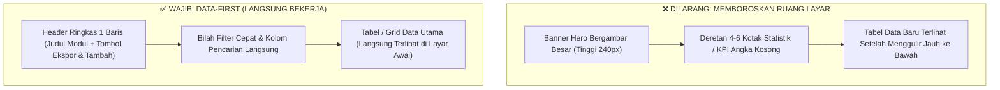
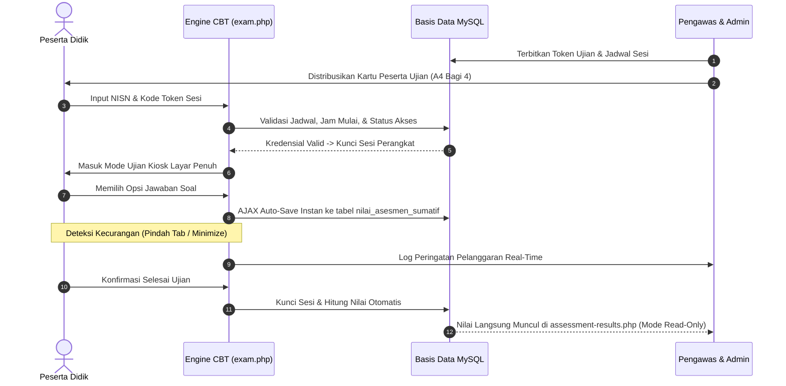
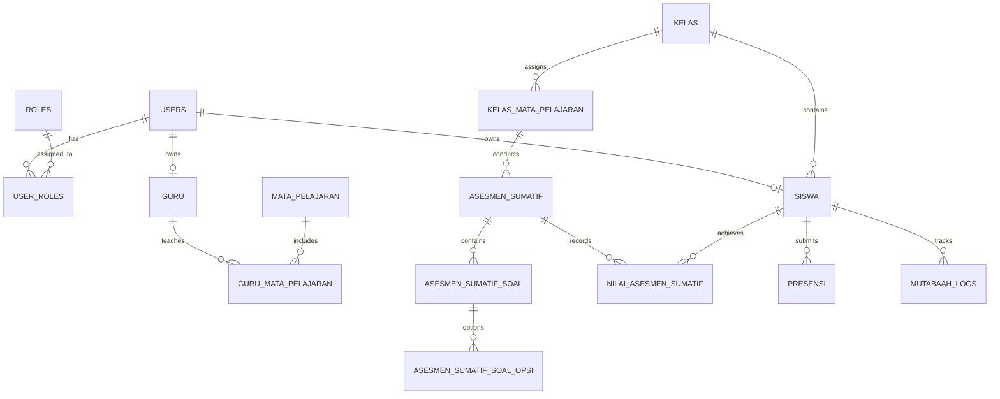

<div align="center">

  <!-- LOGO RESMI ILMUNA LEARN -->
  <a href="#-ilmuna-learn--siakad--lms-nusantara">
    
  </a>

  # 🎓 ILMUNA LEARN
  ### Sistem Informasi Akademik (SIAKAD) & Learning Management System (LMS)
  **Platform Edukasi Terpadu Kurikulum Merdeka & Pendidikan Agama Islam (PAI) Berpadu Sentuhan Luhur Budaya Nusantara**

  <p align="center">
    <a href="https://php.net"></a>
    <a href="https://mysql.com"></a>
    <a href="#3-design-system-tema-lumina-gold--sentuhan-nusantara"></a>
    <a href="#2-sistem-notifikasi--dialog-global-ilmuna-ui"></a>
    <a href="#4-filosofi-desain-data-first-anti-hero--anti-statistik-mubazir"></a>
    <a href="#5-standar-responsivitas-mobile--layar-smartphone"></a>
  </p>

  <!-- QUICK NAVIGATION PILLS (RESPONSIVE WRAPPER) -->
  <p align="center">
    <a href="#1-profil--arsitektur-teknologi-sistem"><kbd>🚀 Profil & Arsitektur</kbd></a> &nbsp;
    <a href="#2-sistem-notifikasi--dialog-global-ilmuna-ui"><kbd>🔔 Standar Alert & Dialog</kbd></a> &nbsp;
    <a href="#3-design-system-tema-lumina-gold--sentuhan-nusantara"><kbd>🎨 Tema & Warna</kbd></a> &nbsp;
    <a href="#4-filosofi-desain-data-first-anti-hero--anti-statistik-mubazir"><kbd>📊 Prinsip Data-First</kbd></a> &nbsp;
    <a href="#5-standar-responsivitas-mobile--layar-smartphone"><kbd>📱 Standar Mobile</kbd></a> &nbsp;
    <a href="#6-inventaris-lengkap-51-modul-dashboard"><kbd>🏛️ 51 Modul</kbd></a> &nbsp;
    <a href="#8-skema-resmi-69-tabel-basis-data"><kbd>🗄️ 69 Tabel DB</kbd></a> &nbsp;
    <a href="#9-panduan-pengembang-ai-ai-assistant-blueprint--prompting-rules"><kbd>🤖 Panduan AI</kbd></a>
  </p>

</div>

---

<!-- 4 KARTU FITUR PILAR DENGAN FORMAT RESPONSIVE -->
<div align="center">
  <table>
    <tr>
      <td align="center" width="25%" style="padding: 12px; vertical-align: top;">
        <br>
        <b>⚡ PHP 8.2 Native</b><br>
        <sub>Arsitektur murni PDO Singleton tanpa framework berat. Respon super cepat dan hemat RAM di server hosting cPanel & VPS.</sub>
      </td>
      <td align="center" width="25%" style="padding: 12px; vertical-align: top;">
        <br>
        <b>🛡️ Kiosk Exam Browser</b><br>
        <sub>Lock screen, deteksi tab switch, blokir pintasan keyboard, auto-save instan per butir, & cetak kartu peserta PDF A4 dibagi 4.</sub>
      </td>
      <td align="center" width="25%" style="padding: 12px; vertical-align: top;">
        <br>
        <b>📍 Validasi GPS & QR</b><br>
        <sub>Validasi jarak radius gerbang sekolah berbasis satelit GPS (Formula Haversine) serta generator token QR harian dinamis.</sub>
      </td>
      <td align="center" width="25%" style="padding: 12px; vertical-align: top;">
        <br>
        <b>📖 Amalan & E-Rapor</b><br>
        <sub>Jurnal ibadah harian (Sholat 5 waktu, Dhuha, Tahajud, Tilawah) yang otomatis tersinkronisasi ke nilai sikap spiritual E-Rapor.</sub>
      </td>
    </tr>
  </table>
</div>

---

## 📑 DAFTAR ISI DOKUMENTASI

- [1. 🚀 Profil & Arsitektur Teknologi Sistem](#1--profil--arsitektur-teknologi-sistem)
  - [1.1 Spesifikasi Inti Stack](#11-spesifikasi-inti-stack)
  - [1.2 Pohon Struktur Berkas Proyek](#12-pohon-struktur-berkas-proyek)
- [2. 🔔 Sistem Notifikasi & Dialog Global (Ilmuna UI)](#2--sistem-notifikasi--dialog-global-ilmuna-ui)
  - [2.1 Anatomi & Ciri Khas Desain Nusantara](#21-anatomi--ciri-khas-desain-nusantara)
  - [2.2 Larangan Keras Alert Browser & Pustaka Pihak Ketiga](#22-larangan-keras-alert-browser--pustaka-pihak-ketiga)
  - [2.3 Dokumentasi Lengkap Method `window.Ilmuna`](#23-dokumentasi-lengkap-method-windowilmuna)
- [3. 🎨 Design System: Tema Lumina Gold & Sentuhan Nusantara](#3--design-system-tema-lumina-gold--sentuhan-nusantara)
  - [3.1 Design Tokens & Palet Warna Resmi](#31-design-tokens--palet-warna-resmi)
  - [3.2 Tipografi & Penskalaan Huruf](#32-tipografi--penskalaan-huruf)
  - [3.3 Komponen UI Standar (Tombol, Badge, Form)](#33-komponen-ui-standar-tombol-badge-form)
- [4. 📊 Filosofi Desain "Data-First" (Anti-Hero & Anti-Statistik Mubazir)](#4--filosofi-desain-data-first-anti-hero--anti-statistik-mubazir)
  - [4.1 Aturan Mutlak Larangan Tata Letak](#41-aturan-mutlak-larangan-tata-letak)
  - [4.2 Cetak Biru Standar Halaman Data](#42-cetak-biru-standar-halaman-data)
- [5. 📱 Standar Responsivitas Mobile & Layar Smartphone](#5--standar-responsivitas-mobile--layar-smartphone)
  - [5.1 Breakpoint & Resolusi Layar Uji (360px – 430px)](#51-breakpoint--resolusi-layar-uji-360px--430px)
  - [5.2 Spesifikasi UX Mobile Wajib](#52-spesifikasi-ux-mobile-wajib)
  - [5.3 Transformasi Tabel Responsif ke Card Stack](#53-transformasi-tabel-responsif-ke-card-stack)
- [6. 🏛️ Inventaris Lengkap 51 Modul Dashboard](#6-️-inventaris-lengkap-51-modul-dashboard)
  - [6.1 Panel Administrator (34 Berkas PHP)](#61-panel-administrator-34-berkas-php)
  - [6.2 Panel Pengajar / Guru (7 Berkas PHP)](#62-panel-pengajar--guru-7-berkas-php)
  - [6.3 Portal Peserta Didik / Siswa (6 Berkas PHP)](#63-portal-peserta-didik--siswa-6-berkas-php)
  - [6.4 Panel Ketua Kelas (4 Berkas PHP)](#64-panel-ketua-kelas-4-berkas-php)
- [7. ⚙️ Sub-Sistem Utama (CBT, Presensi GPS, Mutaba'ah, E-Rapor)](#7-️-sub-sistem-utama-cbt-presensi-gps-mutabaah-e-rapor)
  - [7.1 Mesin CBT & Ujian Anti-Curang (`exam.php`)](#71-mesin-cbt--ujian-anti-curang-examphp)
  - [7.2 Presensi Mandiri GPS Geofencing (Formula Haversine)](#72-presensi-mandiri-gps-geofencing-formula-haversine)
  - [7.3 Mutaba'ah Yaumiyah & Pembiasaan Karakter PAI](#73-mutabaah-yaumiyah--pembiasaan-karakter-pai)
  - [7.4 E-Rapor Kurikulum Merdeka](#74-e-rapor-kurikulum-merdeka)
- [8. 🗄️ Skema Resmi 69 Tabel Basis Data](#8-️-skema-resmi-69-tabel-basis-data)
- [9. 🤖 Panduan Pengembang AI (AI Assistant Blueprint & Prompting Rules)](#9--panduan-pengembang-ai-ai-assistant-blueprint--prompting-rules)
  - [9.1 5 Hukum Wajib AI Developer](#91-5-hukum-wajib-ai-developer)
  - [9.2 Boilerplate Lengkap Pembuatan Modul Baru](#92-boilerplate-lengkap-pembuatan-modul-baru)
- [10. 🛠️ Panduan Instalasi Lingkungan & Troubleshooting](#10-️-panduan-instalasi-lingkungan--troubleshooting)

---

## 1. 🚀 PROFIL & ARSITEKTUR TEKNOLOGI SISTEM

### 1.1 Spesifikasi Inti Stack

<div align="center">
  <table>
    <tr>
      <td width="20%"><b>Komponen</b></td>
      <td width="40%"><b>Teknologi Terpasang</b></td>
      <td width="40%"><b>Karakteristik & Keunggulan</b></td>
    </tr>
    <tr>
      <td><b>Backend Core</b></td>
      <td></td>
      <td>Murni tanpa framework (No Laravel/CI). Eksekusi instan mikrodetik, hemat memori RAM, siap di cPanel & VPS.</td>
    </tr>
    <tr>
      <td><b>Database Driver</b></td>
      <td></td>
      <td>Singleton Connection, 100% Parameterized Prepared Statements, Transaksi ACID multi-tabel, Charset <code>utf8mb4</code>.</td>
    </tr>
    <tr>
      <td><b>Frontend</b></td>
      <td></td>
      <td>Asynchronous Fetch API, CSS Grid, Flexbox, tanpa runtime compiler berat (No React, Vue, jQuery).</td>
    </tr>
    <tr>
      <td><b>Icon Engine</b></td>
      <td></td>
      <td>Web Components modern dimuat secara deferred/non-blocking dengan fallback ikon FontAwesome 6.</td>
    </tr>
    <tr>
      <td><b>PWA Engine</b></td>
      <td></td>
      <td>Mendukung <code>manifest.json</code>, instalasi homescreen Android/iOS, dan fallback offline caching (<code>sw.js</code>).</td>
    </tr>
    <tr>
      <td><b>Exambro Kiosk</b></td>
      <td></td>
      <td>Aplikasi Android mandiri pengunci layar ujian (Lock task mode, cegah screenshot, split-screen, & floating apps).</td>
    </tr>
    <tr>
      <td><b>PDF Engine</b></td>
      <td></td>
      <td>Render kartu ujian sumatif (A4 dibagi 4) dan lembar token presisi dalam 3–5 detik via isolated profile.</td>
    </tr>
  </table>
</div>

### 1.2 Pohon Struktur Berkas Proyek

```text
c:\laragon\www\learn\
├── 📂 android-exam-browser/            # Source code aplikasi Android Kiosk Exam Browser (Gradle Project)
├── 📂 api/                             # Endpoint API publik & privat untuk pertukaran data JSON
├── 📂 assets/
│   ├── 📂 css/
│   │   ├── lumina-lms.css              # Stylesheet tema inti Lumina Gold LMS (Variabel, reset, tombol, layout)
│   │   ├── admin-assessment-access.css # Style khusus modul kredensial asesmen CBT
│   │   ├── admin-assessment-questions.css # Style khusus bank soal & opsi jawaban
│   │   ├── admin-assessment-results.css# Style khusus rekap nilai asesmen (Mode View-Only)
│   │   ├── admin-assessments.css       # Style master jadwal & pembuatan asesmen
│   │   ├── admin-classes.css           # Style manajemen rombel kelas
│   │   ├── admin-students.css          # Style manajemen data peserta didik
│   │   ├── admin-teachers.css          # Style manajemen dewan pengajar
│   │   └── admin-users.css             # Style manajemen akun portal & sandi
│   ├── 📂 js/
│   │   ├── alert.js                    # MODUL RESMI TEMPLATE DIALOG & TOAST NUSANTARA TOUCH (window.Ilmuna)
│   │   ├── admin-assessment-access.js
│   │   ├── admin-assessment-questions.js
│   │   ├── admin-assessment-results.js
│   │   └── admin-assessments.js
│   ├── 📂 images/ & 📂 img/
│   │   ├── logo-learn.png              # Logo resmi Ilmuna Learn
│   │   ├── landscape-logo-learn.png    # Logo horizontal resolusi tinggi
│   │   ├── icon.png                    # Icon aplikasi
│   │   ├── logo.ico                    # Favicon resmi
│   │   └── gunungan.png                # Watermark ornamen budaya Gunungan Wayang
├── 📂 dashboard/
│   ├── 📂 admin/                       # 34 berkas modul pengelola SIAKAD & LMS
│   ├── 📂 guru/                        # 7 berkas modul pengajar
│   ├── 📂 siswa/                       # 6 berkas portal peserta didik
│   └── 📂 ketua-kelas/                 # 4 berkas panel ketua rombel
├── 📂 includes/
│   ├── header.php                      # Template shell atas, navigasi topbar, sidebar, assets loader
│   ├── footer.php                      # Template shell bawah, script loader, inisialisasi tanggal
│   ├── sidebar.php                     # Logika pembentukan menu dinamis berbasis hak akses role
│   ├── kartu-ujian-sumatif-pdf.php     # Generator PDF Kartu Peserta Asesmen Sumatif (A4 Dibagi 4)
│   └── daftar-token-asesmen-pdf.php    # Generator PDF Lembar Rekap Token Asesmen per Ruang
├── 📂 uploads/                         # Direktori penyimpanan berkas foto profil siswa/guru & lampiran
├── 📄 config.php                       # Konfigurasi path absolut (BASE_PATH), URL (BASE_URL), dan DB
├── 📄 auth.php                         # Middleware autentikasi sesi, multi-role switch, sanitasi
├── 📄 database.php                     # Singleton koneksi PDO MySQL & fungsi pembantu database
├── 📄 exam.php                         # Engine pelaksanaan ujian CBT siswa (Anti-Cheat Kiosk)
├── 📄 login.php / logout.php           # Autentikasi portal masuk & pembersihan sesi keluar
├── 📄 profile.php                      # Manajemen profil pengguna, ganti foto, & ubah password
├── 📄 switch-role.php                  # Pengalihan hak akses multi-peran akun ganda
├── 📄 manifest.json & sw.js            # PWA manifest & Service Worker caching
└── 📄 README.md                        # Single Source of Truth arsitektur sistem (Dokumen ini)
```

---

## 2. 🔔 SISTEM NOTIFIKASI & DIALOG GLOBAL (ILMUNA UI)

> [!IMPORTANT]
> **ATURAN MUTLAK SISTEM ALERT & MODAL:**
> 1. Dilarang menggunakan fungsi JavaScript bawaan browser: `alert()`, `confirm()`, atau `prompt()`.
> 2. Dilarang mengimpor pustaka dialog pihak ketiga (SweetAlert, SweetAlert2, Toastr, Bootstrap Modal, dsb.).
> 3. Seluruh dialog peringatan, konfirmasi penghapusan, pesan sukses, galat, dan dialog keluar akun **WAJIB** menggunakan modul kustom:
>    **[`assets/js/alert.js`](file:///c:/laragon/www/learn/assets/js/alert.js)** melalui objek global **`window.Ilmuna`**.

### 2.1 Anatomi & Ciri Khas Desain Nusantara
Template notifikasi `alert.js` dirancang dengan menyatukan keindahan seni budaya Indonesia dan kenyamanan antarmuka modern:

<div align="center">
  <table>
    <tr>
      <td width="20%" align="center">
        <br>
        <b>Watermark Gunungan</b>
      </td>
      <td width="80%">
        Siluet ornamen Gunungan Wayang Jawa samar (<code>opacity: 0.08</code> pada modal dan <code>0.10</code> pada toast) di pojok kanan bawah setiap kotak pemberitahuan.
      </td>
    </tr>
    <tr>
      <td width="20%" align="center">
        <br>
        <b>Tekstur Kawung</b>
      </td>
      <td width="80%">
        Pola latar belakang geometris Batik Kawung dengan opasitas 3% yang lembut dan bersih pada kanvas putih.
      </td>
    </tr>
    <tr>
      <td width="20%" align="center">
        <br>
        <b>Ornamen Sudut Vektor</b>
      </td>
      <td width="80%">
        Aksen vektor SVG Batik klasik di sudut kiri atas (<code>ORNAMENT_TL</code>), kanan atas (<code>ORNAMENT_TR</code>), dan kiri bawah (<code>ORNAMENT_BL</code>).
      </td>
    </tr>
    <tr>
      <td width="20%" align="center">
        <br>
        <b>Geometri Asimetris</b>
      </td>
      <td width="80%">
        Bentuk sudut melengkung modern berkarakter <code>border-radius: 32px 0 16px 0</code> dengan bayangan elevasi halus.
      </td>
    </tr>
  </table>
</div>

### 2.2 Larangan Keras Alert Browser & Pustaka Pihak Ketiga

```javascript
// ❌ CONTOH KESALAHAN YANG DILARANG KERAS:
alert('Data berhasil disimpan');
if (confirm('Yakin hapus data ini?')) { ... }
Swal.fire('Sukses', 'Data tersimpan', 'success'); // Dilarang SweetAlert!

// ✅ CARA BENAR & WAJIB (MENGGUNAKAN WINDOW.ILMUNA):
Ilmuna.toast('success', 'Berhasil Disimpan', 'Data siswa berhasil diperbarui ke server.');
const yakin = await Ilmuna.confirm('error', 'Hapus Data?', 'Data tidak dapat dipulihkan.');
if (yakin) { ... }
```

### 2.3 Dokumentasi Lengkap Method `window.Ilmuna`

#### A. Notifikasi Toast Mengambang (`Ilmuna.toast`)
Toast notifikasi melayang di sudut kanan atas layar dengan bilah aksen tema:
```javascript
/**
 * Menampilkan notifikasi toast mengambang
 * @param {string} type - 'success' | 'info' | 'warning' | 'error'
 * @param {string} title - Judul ringkas notifikasi
 * @param {string} message - Pesan penjelasan
 * @param {number} [duration=4000] - Durasi tampil (ms). Berikan 0 jika ingin sticky (tidak auto-close)
 */
Ilmuna.toast('success', 'Berhasil Disimpan', 'Data rombel kelas 10-A telah diperbarui.');

// Toast Gagal Permanen (Tidak otomatis menutup sebelum ditutup pengguna)
Ilmuna.toast('error', 'Koneksi Terputus', 'Gagal menyambung ke server basis data.', 0);

// Shortcut Helper Cepat:
Ilmuna.success('Berhasil', 'Nilai asesmen siswa berhasil direkap!');
Ilmuna.info('Informasi', 'Sesi ujian sumatif dimulai pukul 08:00 WIB.');
Ilmuna.warning('Perhatian', 'Batas unggah tugas tersisa 30 menit.');
Ilmuna.error('Gagal', 'Format berkas Excel tidak valid.');
```

#### B. Modal Dialog Konfirmasi (`Ilmuna.confirm` & `Ilmuna.alert`)
Dialog interaktif berlatar belakang kabur (*backdrop blur*) untuk konfirmasi keputusan penting:
```javascript
/**
 * 1. Dialog Konfirmasi Berbasis Promise (Modern Async / Await) — SANGAT DISARANKAN
 * @param {string} type - 'success' | 'info' | 'warning' | 'error' | 'logout'
 * @param {string} title - Judul modal konfirmasi
 * @param {string} message - Pertanyaan / dampak aksi
 * @param {string} [confirmText='Ya, Lanjutkan'] - Label tombol konfirmasi
 * @param {string} [cancelText='Batal'] - Label tombol batal
 * @returns {Promise<boolean>}
 */
async function hapusDataSiswa(idSiswa) {
    const konfirmasi = await Ilmuna.confirm(
        'error',                           // Tema warna tombol & ikon: error (Crimson)
        'Hapus Data Siswa?',               // Judul modal
        'Seluruh riwayat nilai dan kehadiran siswa akan dihapus permanen.', // Pesan
        'Ya, Hapus Data',                  // Teks tombol konfirmasi
        'Batal'                            // Teks tombol batal
    );

    if (!konfirmasi) return; // Pengguna membatalkan

    try {
        const resp = await fetch('api/students-delete.php', {
            method: 'POST',
            headers: { 'Content-Type': 'application/json' },
            body: JSON.stringify({ id: idSiswa })
        });
        const res = await resp.json();
        if (res.success) {
            Ilmuna.success('Berhasil Dihapus', res.message);
            reloadTableData();
        } else {
            Ilmuna.error('Gagal', res.message);
        }
    } catch (err) {
        Ilmuna.error('Kesalahan', 'Gagal menghubungi server.');
    }
}

// 2. Alert Sederhana (Hanya tombol Mengerti / OK)
Ilmuna.alert('info', 'Pembaruan Kurikulum', 'Versi Capaian Pembelajaran telah diperbarui.', 'Mengerti');
```

#### C. Dialog Konfirmasi Logout (`Ilmuna.logout`)
Fitur keluar sesi yang seragam di seluruh peran:
```javascript
// Pemanggilan via JavaScript murni:
Ilmuna.logout(); // Menuju BASE_URL/logout.php secara default

// Auto-binding pada elemen HTML tanpa baris script tambahan:
<a href="/logout.php" data-ilm-logout>Keluar Akun</a>
<button type="button" data-ilm-logout="/custom-logout-url.php">Keluar</button>
```

---

## 3. 🎨 DESIGN SYSTEM: TEMA LUMINA GOLD & SENTUHAN NUSANTARA

Tema visual **Lumina Gold** memadukan wibawa akademis modern dengan keelokan budaya Nusantara.

### 3.1 Design Tokens & Palet Warna Resmi

<div align="center">
  <table>
    <tr>
      <td width="20%"><b>Token CSS</b></td>
      <td width="15%"><b>Kode Hex</b></td>
      <td width="15%" align="center"><b>Sampel Warna</b></td>
      <td width="50%"><b>Peruntukan & Makna Visual</b></td>
    </tr>
    <tr>
      <td><code>--lumina-navy</code></td>
      <td><code>#1D3B5E</code></td>
      <td align="center"></td>
      <td>Warna brand otoritas utama, teks heading, border header topbar.</td>
    </tr>
    <tr>
      <td><code>--lumina-teal</code></td>
      <td><code>#0D7A87</code></td>
      <td align="center"></td>
      <td>Warna brand sekunder, tombol Call-to-Action utama, active menu state.</td>
    </tr>
    <tr>
      <td><code>--lumina-sky</code></td>
      <td><code>#52B2DC</code></td>
      <td align="center"></td>
      <td>Aksen interaktif cerah, fokus input form, badge info, efek glow.</td>
    </tr>
    <tr>
      <td><code>--lumina-gold</code></td>
      <td><code>#F59E0B</code></td>
      <td align="center"></td>
      <td>Elemen prestisius, koin gamifikasi, token ujian CBT, bintang prestasi.</td>
    </tr>
    <tr>
      <td><code>--lumina-emerald</code></td>
      <td><code>#10B981</code></td>
      <td align="center"></td>
      <td>Status aktif, presensi hadir tepat waktu, toast notifikasi sukses.</td>
    </tr>
    <tr>
      <td><code>--lumina-amber</code></td>
      <td><code>#D97706</code></td>
      <td align="center"></td>
      <td>Peringatan sistem, status terlambat, status pengerjaan remedial.</td>
    </tr>
    <tr>
      <td><code>--lumina-rose</code></td>
      <td><code>#EF4444</code></td>
      <td align="center"></td>
      <td>Aksi destruktif hapus data, status sesi terkunci, status alpa/absen.</td>
    </tr>
    <tr>
      <td><code>--lumina-bg-canvas</code></td>
      <td><code>#F8FAFC</code></td>
      <td align="center"></td>
      <td>Latar belakang kanvas halaman sejuk, bersih, dan nyaman di mata.</td>
    </tr>
    <tr>
      <td><code>--lumina-bg-card</code></td>
      <td><code>#FFFFFF</code></td>
      <td align="center"></td>
      <td>Permukaan kartu data, panel toolbar, dan jendela dialog modal.</td>
    </tr>
  </table>
</div>

### 3.2 Tipografi & Penskalaan Huruf
- **Headings (`h1`, `h2`, `h3`, `h4`, `h5`)**: Menggunakan Google Font `'Outfit', sans-serif` dengan bobot 600, 700, dan 800.
- **Body & Form Text**: Menggunakan Google Font `'Plus Jakarta Sans', sans-serif` dengan bobot 400, 500, dan 600.
- **Kode Token & Sandi**: Menggunakan font monospace `'JetBrains Mono', 'Fira Code', Consolas, monospace`.

### 3.3 Komponen UI Standar (Tombol, Badge, Form)

```html
<!-- Contoh Penggunaan Tombol Standar -->
<button class="btn btn-primary"><iconify-icon icon="solar:disk-bold"></iconify-icon> Simpan Data</button>
<button class="btn btn-gold"><iconify-icon icon="solar:key-bold"></iconify-icon> Buat Token</button>
<button class="btn btn-outline"><iconify-icon icon="solar:refresh-bold"></iconify-icon> Reset</button>
<button class="btn btn-danger"><iconify-icon icon="solar:trash-bin-trash-bold"></iconify-icon> Hapus</button>

<!-- Badges Status -->
<span class="ilmuna-badge ilmuna-badge--success">Aktif</span>
<span class="ilmuna-badge ilmuna-badge--warning">Sedang Mengerjakan</span>
<span class="ilmuna-badge ilmuna-badge--danger">Terkunci</span>
<span class="ilmuna-badge ilmuna-badge--info">Fase E</span>
```

---

## 4. FILOSOFI DESAIN "DATA-FIRST" (ANTI-HERO & ANTI-STATISTIK MUBAZIR)

> [!WARNING]
> **ATURAN MUTLAK TATA LETAK HALAMAN DATA:**
> Pada seluruh sub-halaman dashboard (Data Siswa, Data Guru, Data Kelas, Jadwal, Kurikulum, Asesmen, Presensi, Mutabaah, Nilai, dll.):
> 
> 1. **DILARANG MEMASANG BANNER HERO**: Jangan memasang banner dekoratif besar, poster bergambar kartun, ucapan "Selamat Datang..." yang memboroskan tinggi layar 150px–300px.
> 2. **DILARANG MENAMPILKAN WIDGET STATISTIK BERLEBIHAN**: Jangan memasang barisan 4–6 kotak metrik KPI di atas tabel yang menenggelamkan data utama ke bawah layar. Statistik hanya diperbolehkan pada Beranda Utama (`index.php`) masing-masing peran secara proporsional.
> 3. **LANGSUNG TAMPILKAN DATA (DATA-FIRST)**: Pengguna datang untuk memproses data. Layout harus langsung menyajikan: **Compact Header -> Toolbar Filter & Pencarian -> Tabel / Grid Data Utama**.

### 4.1 Aturan Mutlak Larangan Tata Letak



### 4.2 Cetak Biru Standar Halaman Data

```html
<!-- 1. HEADER RINGKAS DATA-FIRST (Tinggi Maksimal 56px) -->
<div class="ilmuna-page-header">
    <div class="ilmuna-page-header__left">
        <div class="ilmuna-page-icon">
            <iconify-icon icon="solar:users-group-rounded-bold" width="22"></iconify-icon>
        </div>
        <div>
            <h1 class="ilmuna-page-title">Manajemen Data Siswa</h1>
            <p class="ilmuna-page-subtitle">Kelola master peserta didik, rombel kelas, dan akun portal</p>
        </div>
    </div>
    <div class="ilmuna-page-header__actions">
        <button type="button" class="btn btn-outline" id="btnExport">
            <iconify-icon icon="solar:file-download-bold"></iconify-icon> Ekspor Excel
        </button>
        <button type="button" class="btn btn-primary" id="btnTambah">
            <iconify-icon icon="solar:add-circle-bold"></iconify-icon> Tambah Siswa
        </button>
    </div>
</div>

<!-- 2. TOOLBAR FILTER CEPAT & LIVE SEARCH -->
<div class="ilmuna-toolbar">
    <div class="ilmuna-toolbar__filters">
        <div class="ilmuna-filter-group">
            <label for="filterKelas">Rombel:</label>
            <select id="filterKelas" class="ilmuna-select">
                <option value="0">— Semua Kelas —</option>
            </select>
        </div>
        <div class="ilmuna-search-group">
            <iconify-icon icon="solar:magnifer-linear"></iconify-icon>
            <input type="text" id="searchInput" placeholder="Cari NISN, nama lengkap, WhatsApp..." autocomplete="off">
        </div>
    </div>
</div>

<!-- 3. DATA CONTAINER (TABEL / GRID DATA FOKUS UTAMA) -->
<div class="ilmuna-card">
    <div class="table-responsive">
        <table class="ilmuna-table" id="dataTable">
            <thead>
                <tr>
                    <th width="40">No</th>
                    <th>Nama Lengkap</th>
                    <th>NISN / NIS</th>
                    <th>Kelas</th>
                    <th>Status</th>
                    <th width="120" class="text-center">Aksi</th>
                </tr>
            </thead>
            <tbody id="tableBody">
                <!-- Baris Data Dimuat Langsung -->
            </tbody>
        </table>
    </div>
    <!-- 4. PAGINASI RINGKAS -->
    <div class="ilmuna-pagination-wrap" id="paginationWrap"></div>
</div>
```

---

## 5. 📱 STANDAR RESPONSIVITAS MOBILE & LAYAR SMARTPHONE

Ilmuna Learn digunakan secara masif melalui ponsel pintar. Tampilan mobile merupakan **prioritas utama**, bukan sekadar hasil perkecilan desktop.

### 5.1 Breakpoint & Resolusi Layar Uji (360px – 430px)

<div align="center">
  <table>
    <tr>
      <td width="25%"><b>Kategori Layar</b></td>
      <td width="20%"><b>Resolusi Lebar</b></td>
      <td width="25%"><b>Perangkat Uji Contoh</b></td>
      <td width="30%"><b>Karakteristik Tampilan UI</b></td>
    </tr>
    <tr>
      <td></td>
      <td><code>360px – 380px</code></td>
      <td>Samsung Galaxy A03, Redmi 9A</td>
      <td>1 Kolom penuh, padding horizontal 12px, font form 15px.</td>
    </tr>
    <tr>
      <td></td>
      <td><code>390px – 414px</code></td>
      <td>iPhone 13/14/15, Galaxy S23</td>
      <td>Filter bertumpuk rapi, touch target 44px, bottom dock aktif.</td>
    </tr>
    <tr>
      <td></td>
      <td><code>428px – 440px</code></td>
      <td>iPhone Pro Max, Galaxy Ultra</td>
      <td>Kartu data compact, padding 16px, modal terpusat proporsional.</td>
    </tr>
    <tr>
      <td></td>
      <td><code>768px – 1024px</code></td>
      <td>iPad Air, Galaxy Tab</td>
      <td>Grid 2 kolom, tabel scrollable mulus, topbar adaptif.</td>
    </tr>
    <tr>
      <td></td>
      <td><code>> 1024px</code></td>
      <td>Laptop, Monitor Komputer</td>
      <td>Layout penuh dengan sidebar navigasi permanen kiri 265px.</td>
    </tr>
  </table>
</div>

### 5.2 Spesifikasi UX Mobile Wajib
1. **Zero Horizontal Overflow (`overflow-x: hidden`)**: Seluruh bodi halaman dilarang mengalami pergeseran layar horizontal yang tidak disengaja.
2. **Touch Target Minimal 44px x 44px**: Seluruh tombol, tombol ikon, dropdown, checkbox, dan tautan menu wajib memiliki luas sentuh minimal 44 piksel agar ramah jempol.
3. **Penskalaan Tipografi Proporsional**:
   - Judul Halaman (`h1`): Turun dari `1.75rem` (desktop) menjadi `1.25rem - 1.35rem` di mobile.
   - Teks Form Input: Minimum `15px - 16px` untuk mencegah efek *auto-zoom* peramban iOS Safari.
   - Teks Tabel/Card: `12.5px - 13.5px` dengan kontras keterbacaan tinggi.
4. **Bottom Dock Navigation (Navigasi Bawah Jempol)**:
   Pada resolusi mobile (`<= 768px`), sidebar desktop secara otomatis disembunyikan dan digantikan oleh bilah navigasi bawah (*Bottom Navigation Dock*) yang memperhitungkan `env(safe-area-inset-bottom)`.

### 5.3 Transformasi Tabel Responsif ke Card Stack

```css
@media (max-width: 768px) {
    /* Stack Filter Toolbar Secara Vertikal */
    .ilmuna-toolbar__filters {
        flex-direction: column;
        align-items: stretch;
        gap: 10px;
    }
    .ilmuna-filter-group, .ilmuna-search-group {
        width: 100% !important;
    }
    .ilmuna-search-group input {
        width: 100% !important;
        font-size: 15px !important;
        min-height: 44px;
    }

    /* Transformasi Baris Tabel Menjadi Card Stack */
    .ilmuna-table-stack thead { display: none; }
    .ilmuna-table-stack tbody tr {
        display: block;
        background: #ffffff;
        border: 1px solid var(--lumina-border);
        border-radius: 14px;
        padding: 14px;
        margin-bottom: 12px;
        box-shadow: var(--shadow-sm);
    }
    .ilmuna-table-stack tbody td {
        display: flex;
        justify-content: space-between;
        align-items: center;
        padding: 8px 0;
        border-bottom: 1px solid #f1f5f9;
    }
    .ilmuna-table-stack tbody td:last-child {
        border-bottom: none;
        padding-top: 12px;
        justify-content: flex-end;
    }
    .ilmuna-table-stack tbody td::before {
        content: attr(data-label);
        font-weight: 700;
        font-size: 12px;
        color: var(--lumina-navy);
        text-transform: uppercase;
    }
}
```

---

## 6. 🏛️ INVENTARIS LENGKAP 51 MODUL DASHBOARD

Berikut adalah rincian lengkap 51 berkas modul PHP yang menyusun antarmuka 4 peran pengguna di Ilmuna Learn:

### 6.1 Panel Administrator (34 Berkas PHP)

<details open>
<summary><b>👑 Buka / Tutup Daftar 34 Modul Panel Administrator (Klik di sini)</b></summary>
<br>

| No | Berkas di `dashboard/admin/` | Kategori | Fungsi & Fungsionalitas Lengkap |
| :-: | :--- | :---: | :--- |
| 1 | `index.php` | <kbd>Ringkasan</kbd> | Beranda ringkasan eksekutif, status server, pintasan akses cepat CBT, Presensi, Geofencing, dan Siswa. |
| 2 | `identitas-sekolah.php` | <kbd>Kelembagaan</kbd> | Pengaturan identitas resmi sekolah: nama sekolah, NPSN, akreditasi, alamat, logo, dan kop surat. |
| 3 | `school-profile.php` | <kbd>Kelembagaan</kbd> | Profil lengkap sekolah untuk transkrip E-Rapor dan dokumen cetak resmi. |
| 4 | `curriculum.php` | <kbd>Kurikulum</kbd> | Master Kurikulum Merdeka: Fase fondasi/A/B/C/D/E/F, Capaian Pembelajaran (CP), Tujuan Pembelajaran (TP). |
| 5 | `classes.php` | <kbd>Akademik</kbd> | Manajemen rombel kelas: tingkat kelas (7-12), jurusan, kapasitas kursi, dan penugasan wali kelas. |
| 6 | `classes-excel.php` | <kbd>Ekspor</kbd> | Generator ekspor data rombongan belajar ke format spreadsheet Excel (.xlsx). |
| 7 | `teachers.php` | <kbd>Kepegawaian</kbd> | Master data dewan guru & staf pengajar: NIP, NUPTK, jabatan, mapel yang diampu, dan aktivasi akun portal. |
| 8 | `teachers-excel.php` | <kbd>Ekspor</kbd> | Generator ekspor master data dewan guru ke format spreadsheet Excel (.xlsx). |
| 9 | `students.php` | <kbd>Kesiswaan</kbd> | Master data peserta didik: NISN, NIS, nama lengkap, kontak WhatsApp wali, foto profil, dan impor Excel. |
| 10 | `students-excel.php` | <kbd>Ekspor</kbd> | Generator ekspor dan template impor data siswa format Excel (.xlsx). |
| 11 | `subjects.php` | <kbd>Akademik</kbd> | Master mata pelajaran PAI (Al-Qur'an Hadits, Akidah Akhlak, Fikih, SKI) dan mata pelajaran umum. |
| 12 | `subjects-excel.php` | <kbd>Ekspor</kbd> | Generator ekspor daftar mata pelajaran ke format Excel (.xlsx). |
| 13 | `schedules.php` | <kbd>Akademik</kbd> | Manajemen jadwal pelajaran mingguan per kelas, alokasi jam tatap muka, dan penentuan ruang kelas. |
| 14 | `attendance.php` | <kbd>Presensi</kbd> | Rekap kehadiran siswa harian per rombel dan per mata pelajaran. |
| 15 | `attendance-excel.php` | <kbd>Ekspor</kbd> | Generator ekspor rekap presensi kehadiran siswa ke format Excel (.xlsx). |
| 16 | `presensi-master.php` | <kbd>Presensi</kbd> | Pusat kendali presensi: aktivasi presensi harian, pembuatan token presensi, dan generator kode QR dinamis. |
| 17 | `presensi-token-excel.php` | <kbd>Ekspor</kbd> | Generator ekspor lembar rekap token presensi ke format Excel (.xlsx). |
| 18 | `geofencing.php` | <kbd>Presensi</kbd> | Manajemen titik koordinat GPS gerbang sekolah (Latitude, Longitude, Radius toleransi meter) untuk presensi mandiri. |
| 19 | `materials.php` | <kbd>Pembelajaran</kbd> | Pemantauan materi pembelajaran digital yang diunggah dewan guru di seluruh kelas. |
| 20 | `assignments.php` | <kbd>Pembelajaran</kbd> | Pemantauan tugas siswa, tenggat waktu pengumpulan, dan status penilaian guru. |
| 21 | `assessments.php` | <kbd>CBT / Ujian</kbd> | Master asesmen: jadwal asesmen formatif, sumatif, diagnostik, dan remedial. |
| 22 | `assessments-excel.php` | <kbd>Ekspor</kbd> | Generator ekspor daftar asesmen ke format spreadsheet Excel (.xlsx). |
| 23 | `assessment-questions.php` | <kbd>CBT / Ujian</kbd> | Bank Soal CBT: butir soal pilihan ganda, esai, rubrik nilai, pembobotan, dan penyisipan media gambar/audio. |
| 24 | `assessment-access.php` | <kbd>CBT / Ujian</kbd> | Kredensial Ujian CBT: penerbitan token sesi, monitoring siswa aktif, reset sesi ujian, & cetak kartu. |
| 25 | `assessment-results.php` | <kbd>CBT / Ujian</kbd> | Rekap hasil nilai asesmen dan analisis butir soal (Mode View-Only aman terproteksi dari suntingan liar). |
| 26 | `absensi-sumatif.php` | <kbd>CBT / Ujian</kbd> | Berita acara dan daftar hadir ruang pelaksanaan asesmen sumatif resmi. |
| 27 | `mutabaah.php` | <kbd>Spiritual</kbd> | Monitoring jurnal ibadah yaumiyah seluruh peserta didik (shalat fardhu, dhuha, tahajud, tilawah Al-Qur'an). |
| 28 | `reports.php` | <kbd>E-Rapor</kbd> | Pengelolaan E-Rapor Kurikulum Merdeka: cetak nilai capaian kompetensi, transkrip, dan buku rapor. |
| 29 | `reports-excel.php` | <kbd>Ekspor</kbd> | Generator ekspor rekap nilai E-Rapor ke format Excel (.xlsx). |
| 30 | `reports-pdf.php` | <kbd>Cetak PDF</kbd> | Generator cetak buku E-Rapor format PDF resmi dengan kop sekolah dan tanda tangan kepala sekolah. |
| 31 | `kaldik-excel.php` | <kbd>Ekspor</kbd> | Generator kalender akademik pendidikan format spreadsheet Excel (.xlsx). |
| 32 | `kaldik-pdf.php` | <kbd>Cetak PDF</kbd> | Generator cetak kalender akademik format PDF berwarna. |
| 33 | `users.php` | <kbd>Pengguna</kbd> | Manajemen akun sistem: hak akses role (admin, guru, siswa, ketua kelas), aktivasi status, dan reset sandi. |
| 34 | `users-email-template.php` | <kbd>Pengguna</kbd> | Pengelola templat pesan email aktivasi dan notifikasi kredensial pengguna baru. |

</details>

---

### 6.2 Panel Pengajar / Guru (7 Berkas PHP)

<details open>
<summary><b>👨‍🏫 Buka / Tutup Daftar 7 Modul Panel Pengajar / Guru (Klik di sini)</b></summary>
<br>

| No | Berkas di `dashboard/guru/` | Kategori | Fungsi & Fungsionalitas Lengkap |
| :-: | :--- | :---: | :--- |
| 35 | `index.php` | <kbd>Ringkasan</kbd> | Beranda guru: jadwal mengajar hari ini, tugas siswa yang belum dinilai, dan statistik mengajar. |
| 36 | `absensi.php` | <kbd>Presensi</kbd> | Input presensi kehadiran siswa di kelas per jam pelajaran (Hadir, Izin, Sakit, Alpa). |
| 37 | `scan-qr.php` | <kbd>Presensi</kbd> | Scanner kamera web/ponsel guru untuk memindai kartu QR Code peserta didik di ruang kelas. |
| 38 | `materi.php` | <kbd>Materi</kbd> | Pengunggahan dan pengelolaan modul bahan ajar, dokumen PDF, tautan YouTube, dan ringkasan materi. |
| 39 | `tugas.php` | <kbd>Tugas</kbd> | Pembuatan tugas kelas, panduan pengerjaan, tenggat waktu, dan pengoreksian tugas siswa. |
| 40 | `absensi-sumatif.php` | <kbd>Pengawas</kbd> | Pengawasan ruang asesmen sumatif resmi dan verifikasi kehadiran fisik peserta ujian. |
| 41 | `reports.php` | <kbd>Nilai</kbd> | Penginputan nilai capaian TP (Tujuan Pembelajaran) dan perumusan deskripsi capaian rapor Kurikulum Merdeka. |

</details>

---

### 6.3 Portal Peserta Didik / Siswa (6 Berkas PHP)

<details open>
<summary><b>🎓 Buka / Tutup Daftar 6 Modul Portal Peserta Didik / Siswa (Klik di sini)</b></summary>
<br>

| No | Berkas di `dashboard/siswa/` | Kategori | Fungsi & Fungsionalitas Lengkap |
| :-: | :--- | :---: | :--- |
| 42 | `index.php` | <kbd>Ringkasan</kbd> | Beranda siswa: jadwal kelas aktif, koin prestasi, pengumuman sekolah, dan daftar tugas mendatang. |
| 43 | `absensi.php` | <kbd>Presensi</kbd> | Presensi mandiri berbasis validasi GPS Geofencing radius sekolah dari perangkat ponsel siswa. |
| 44 | `materi.php` | <kbd>Belajar</kbd> | Akses dan unduh bahan ajar serta modul pembelajaran digital dari dewan guru. |
| 45 | `tugas.php` | <kbd>Tugas</kbd> | Daftar penugasan kelas, instruksi guru, dan formulir pengunggahan berkas jawaban tugas (PDF/Foto). |
| 46 | `mutabaah.php` | <kbd>Spiritual</kbd> | Jurnal amalan yaumiyah harian: Sholat 5 waktu, Dhuha, Tahajud, Tadarus Juz 'Amma, dan Puasa Sunnah. |
| 47 | `nilai.php` | <kbd>Rapor</kbd> | Transkrip capaian kompetensi siswa, riwayat nilai tugas, nilai formatif, nilai sumatif, dan rekap rapor. |

</details>

---

### 6.4 Panel Ketua Kelas (4 Berkas PHP)

<details open>
<summary><b>👥 Buka / Tutup Daftar 4 Modul Panel Ketua Kelas (Klik di sini)</b></summary>
<br>

| No | Berkas di `dashboard/ketua-kelas/` | Kategori | Fungsi & Fungsionalitas Lengkap |
| :-: | :--- | :---: | :--- |
| 48 | `index.php` | <kbd>Ringkasan</kbd> | Beranda operasional ketua rombel: agenda kelas hari ini dan status piket kebersihan. |
| 49 | `agenda.php` | <kbd>Jurnal</kbd> | Pengisian jurnal harian kelas: materi yang diajarkan, guru yang hadir, guru berhalangan, dan guru piket. |
| 50 | `presensi.php` | <kbd>Presensi</kbd> | Pengecekan daftar hadir harian rekan-rekan sekelas untuk diserahkan ke wali kelas. |
| 51 | `monitoring.php` | <kbd>Monitoring</kbd> | Pemantauan tugas rombel: melihat daftar nama teman sekelas yang belum mengumpulkan tugas. |

</details>

---

## 7. ⚙️ SUB-SISTEM UTAMA (CBT, PRESENSI GPS, MUTABA'AH, E-RAPOR)

### 7.1 Mesin CBT & Ujian Anti-Curang (`exam.php`)



- **Mekanisme Kiosk Exam**:
  - Deteksi event `visibilitychange`: Jika siswa beralih ke aplikasi lain (seperti WhatsApp, browser pencarian), sistem mencatat log pelanggaran dan menampilkan peringatan bertingkat.
  - Penonaktifan tombol pintas keyboard: Memblokir `F12` (DevTools), `Ctrl+U` (View Source), `Ctrl+C` (Salin), `Ctrl+V` (Tempel), dan klik kanan context menu.
- **Penyimpanan Real-Time Per Butir**: Setiap klik opsi pilihan ganda atau input esai langsung disimpan ke database via *background fetch*. Tidak ada data hilang jika perangkat mati mendadak.
- **Pencetakan Kartu Ujian 4-in-1**: Berkas [`includes/kartu-ujian-sumatif-pdf.php`](file:///c:/laragon/www/learn/includes/kartu-ujian-sumatif-pdf.php) menghasilkan lembar A4 berisi 4 kartu ujian peserta lengkap dengan barcode, logo sekolah, jadwal ujian, dan tanda tangan kepala sekolah via engine Chromium.

### 7.2 Presensi Mandiri GPS Geofencing (Formula Haversine)
Presensi mandiri siswa diverifikasi di sisi server menggunakan rumus matematika Haversine untuk menghitung jarak lingkaran besar antara koordinat satelit GPS perangkat siswa dengan koordinat gerbang sekolah:

$$\Delta\text{lat} = \text{lat}_2 - \text{lat}_1, \quad \Delta\text{lon} = \text{lon}_2 - \text{lon}_1$$
$$a = \sin^2\left(\frac{\Delta\text{lat}}{2}\right) + \cos(\text{lat}_1)\cos(\text{lat}_2)\sin^2\left(\frac{\Delta\text{lon}}{2}\right)$$
$$d = 2 R \cdot \arcsin(\sqrt{a})$$

*(di mana $R = 6.371.000$ meter)*. Jika jarak $d$ melebihi radius batas toleransi (misalnya 100 meter), permohonan presensi ditolak dengan notifikasi dialog `window.Ilmuna`.

### 7.3 Mutaba'ah Yaumiyah & Pembiasaan Karakter PAI
- Mencatat kepatuhan amalan harian: Sholat Shubuh, Dzuhur, Ashar, Maghrib, Isya' berjamaah, Sholat Dhuha, Sholat Tahajud, Tadarus Al-Qur'an (Juz & Ayat), Dzikir, dan Berbakti kepada Orang Tua.
- Rekap bulanan menghasilkan persentase skor spiritualitas yang langsung disinkronkan ke dalam deskripsi nilai Sikap Spiritual E-Rapor Kurikulum Merdeka.

### 7.4 E-Rapor Kurikulum Merdeka
- Penilaian berbasis **Tujuan Pembelajaran (TP)** dan **Capaian Pembelajaran (CP)**.
- Otomatisasi pembentukan deskripsi narasi rapor: mengidentifikasi TP tertinggi yang dicapai siswa dengan sangat baik dan TP yang masih membutuhkan bimbingan lebih lanjut.
- Cetak lembar rapor resmi per siswa dengan format PDF standar Kemendikbudristek / Kemenag.

---

## 8. 🗄️ SKEMA RESMI 69 TABEL BASIS DATA

Sistem didukung oleh **69 tabel resmi** InnoDB (MySQL 8 / MariaDB) yang terorganisasi ke dalam 10 kelompok relasi:



<details open>
<summary><b>🗄️ Buka / Tutup Rincian 69 Tabel Basis Data Menurut Kelompok (Klik di sini)</b></summary>
<br>

| No | Kelompok Relasi | Jumlah Tabel | Daftar Nama Tabel Resmi |
| :-: | :--- | :-: | :--- |
| 1 | **Autentikasi & Pengguna** | 3 Tabel | `users`, `roles`, `user_roles` |
| 2 | **Master Lembaga & Civitas** | 7 Tabel | `identitas_sekolah`, `kelas`, `siswa`, `guru`, `mata_pelajaran`, `guru_mata_pelajaran`, `kelas_mata_pelajaran` |
| 3 | **Struktur Kurikulum Merdeka** | 10 Tabel | `elemen`, `cp` (Capaian Pembelajaran), `tp` (Tujuan Pembelajaran), `atp` (Alur Tujuan Pembelajaran), `itp`, `model_pembelajaran`, `sintaks_model_pembelajaran`, `metode_pembelajaran`, `materi`, `modul_ajar` |
| 4 | **Kalender Akademik & Jam Mengajar** | 10 Tabel | `pekan_efektif`, `hari_efektif`, `alokasi_hari_mengajar`, `distribusi_jtm_tp`, `prota`, `prota_detail`, `prosem`, `prosem_detail`, `prosem_jadwal_mingguan`, `jadwal_pelajaran` |
| 5 | **Presensi & Geofencing** | 4 Tabel | `titik_koordinat_sekolah`, `presensi`, `perizinan`, `absensi` |
| 6 | **Tugas & Lembar Kerja (LKPD)** | 10 Tabel | `tugas`, `tugas_kelompok`, `tugas_kelompok_anggota`, `pengumpulan_tugas`, `nilai_tugas`, `lkpd`, `lkpd_soal`, `lkpd_soal_opsi`, `lkpd_soal_rubrik`, `nilai_lkpd` |
| 7 | **Asesmen Diagnostik** | 5 Tabel | `asesmen_diagnostik`, `asesmen_diagnostik_soal`, `asesmen_diagnostik_soal_opsi`, `asesmen_diagnostik_soal_rubrik`, `nilai_asesmen_diagnostik` |
| 8 | **Asesmen Formatif** | 6 Tabel | `asesmen_formatif`, `asesmen_formatif_soal`, `asesmen_formatif_soal_opsi`, `asesmen_formatif_soal_rubrik`, `akses_asesmen_formatif`, `nilai_asesmen_formatif` |
| 9 | **Asesmen Sumatif & CBT** | 8 Tabel | `asesmen_sumatif`, `asesmen_sumatif_kelas`, `asesmen_sumatif_soal`, `asesmen_sumatif_soal_opsi`, `asesmen_sumatif_soal_rubrik`, `akses_asesmen_sumatif`, `absensi_asesmen_sumatif`, `nilai_asesmen_sumatif` |
| 10 | **Remedial, Pengayaan & Rapor** | 6 Tabel | `pengayaan_remedial`, `pengayaan_remedial_soal`, `pengayaan_remedial_soal_opsi`, `pengayaan_remedial_soal_rubrik`, `nilai_pengayaan_remedial`, `akses_pengayaan_remedial`, `rekap_nilai_siswa_mapel`, `proyek`, `proyek_anggota`, `mutabaah_logs` |

</details>

---

## 9. 🤖 PANDUAN PENGEMBANG AI (AI ASSISTANT BLUEPRINT & PROMPTING RULES)

> [!IMPORTANT]
> **5 HUKUM MUTLAK BAGI ASISTEN AI (GEMINI / ANTIGRAVITY / CLAUDE / GPT):**
> Saat menerima perintah untuk mengembangkan fitur baru, menyunting modul, atau memperbaiki bug:

### 9.1 5 Hukum Wajib AI Developer
1. **HUKUM 1 (DIALOG & NOTIFIKASI)**:
   Wajib menggunakan `window.Ilmuna` dari `assets/js/alert.js`. Jangan menulis `alert()`, `confirm()`, atau memasukkan SweetAlert pihak ketiga!
2. **HUKUM 2 (TATA LETAK DATA-FIRST)**:
   Dilarang menambahkan banner hero atau deretan 4 kotak statistik di atas tabel data! Langsung sajikan: **Header Ringkas 1 Baris -> Toolbar Filter & Pencarian -> Tabel / Grid Data**.
3. **HUKUM 3 (RESPONSIVITAS SMARTPHONE)**:
   Wajib memastikan antarmuka tidak mengalami *horizontal scrollbar* pada viewport 360px–430px. Tombol aksi dan form input minimal tinggi sentuh 44px.
4. **HUKUM 4 (KEAMANAN SQL PREPARED STATEMENTS)**:
   Wajib menggunakan prepared statements PDO MySQL dengan parameter binding. Dilarang melakukan konkatenasi variabel langsung ke query string.
5. **HUKUM 5 (STANDAR FORMAT RESPON JSON)**:
   Seluruh endpoint AJAX / POST wajib mengembalikan format respon JSON seragam:
   ```json
   {
       "success": true,
       "message": "Pesan keberhasilan yang ramah pengguna",
       "data": { }
   }
   ```

### 9.2 Boilerplate Lengkap Pembuatan Modul Baru
Gunakan cetak biru kode berikut saat membuat modul baru di Ilmuna Learn:

```php
<?php
/**
 * ==============================================================================
 * ILMUNA LEARN — MODUL CONTOH STANDAR (DATA-FIRST & MOBILE-FIRST)
 * ==============================================================================
 */
require_once __DIR__ . '/../../config.php';
require_once __DIR__ . '/../../auth.php';

// 1. Otorisasi Hak Akses Role
requireRole('admin');

// 2. Handler AJAX / Backend API
if (isset($_GET['ajax']) && $_GET['ajax'] === '1') {
    header('Content-Type: application/json; charset=utf-8');
    try {
        $stmt = $pdo->prepare("SELECT id, nama_lengkap, nisn FROM siswa WHERE status_siswa = 'Aktif' ORDER BY id DESC LIMIT 50");
        $stmt->execute();
        $rows = $stmt->fetchAll(PDO::FETCH_ASSOC);

        echo json_encode([
            'success' => true,
            'message' => 'Data berhasil dimuat',
            'data'    => $rows
        ]);
    } catch (Throwable $e) {
        http_response_code(500);
        echo json_encode([
            'success' => false,
            'message' => 'Galat server: ' . $e->getMessage()
        ]);
    }
    exit;
}

// 3. Metadata Tampilan Halaman
$pageTitle = 'Master Data Contoh';
$pageIcon  = 'solar:layers-bold';

require_once BASE_PATH . '/includes/header.php';
?>

<!-- 4. HEADER RINGKAS DATA-FIRST (TANPA HERO BANNER) -->
<div class="ilmuna-page-header">
    <div class="ilmuna-page-header__left">
        <div class="ilmuna-page-icon">
            <iconify-icon icon="solar:layers-bold" width="22"></iconify-icon>
        </div>
        <div>
            <h1 class="ilmuna-page-title">Master Data Contoh</h1>
            <p class="ilmuna-page-subtitle">Kelola master data tanpa elemen dekoratif berlebih</p>
        </div>
    </div>
    <div class="ilmuna-page-header__actions">
        <button type="button" class="btn btn-primary" id="btnTambah">
            <iconify-icon icon="solar:add-circle-bold"></iconify-icon> Tambah Data
        </button>
    </div>
</div>

<!-- 5. TOOLBAR PENCARIAN & FILTER -->
<div class="ilmuna-toolbar">
    <div class="ilmuna-toolbar__filters">
        <div class="ilmuna-search-group">
            <iconify-icon icon="solar:magnifer-linear"></iconify-icon>
            <input type="text" id="liveSearch" placeholder="Ketik kata kunci pencarian..." autocomplete="off">
        </div>
    </div>
</div>

<!-- 6. TABEL DATA UTAMA -->
<div class="ilmuna-card">
    <div class="table-responsive">
        <table class="ilmuna-table">
            <thead>
                <tr>
                    <th width="40">No</th>
                    <th>Nama Lengkap</th>
                    <th>NISN</th>
                    <th width="100" class="text-center">Aksi</th>
                </tr>
            </thead>
            <tbody id="tableDataBody">
                <tr>
                    <td colspan="4" class="text-center" style="padding: 30px;">
                        <iconify-icon icon="solar:spinner-line" class="ilmuna-spin" width="24"></iconify-icon> Memuat data...
                    </td>
                </tr>
            </tbody>
        </table>
    </div>
</div>

<!-- 7. SCRIPT LOGIKA DENGAN STANDAR ILMUNA UI -->
<script>
document.addEventListener('DOMContentLoaded', function () {
    const tableBody = document.getElementById('tableDataBody');

    async function loadData() {
        try {
            const resp = await fetch('?ajax=1');
            const res = await resp.json();
            if (!res.success) {
                Ilmuna.error('Gagal Memuat', res.message);
                return;
            }

            if (res.data.length === 0) {
                tableBody.innerHTML = '<tr><td colspan="4" class="text-center" style="padding: 24px; color: #94a3b8;">Belum ada data tersedia.</td></tr>';
                return;
            }

            tableBody.innerHTML = res.data.map((item, idx) => `
                <tr>
                    <td>${idx + 1}</td>
                    <td><strong>${Ilmuna.escape(item.nama_lengkap)}</strong></td>
                    <td><code>${Ilmuna.escape(item.nisn)}</code></td>
                    <td class="text-center">
                        <button type="button" class="btn btn-sm btn-outline btn-delete" data-id="${item.id}" title="Hapus">
                            <iconify-icon icon="solar:trash-bin-trash-bold"></iconify-icon>
                        </button>
                    </td>
                </tr>
            `).join('');

            // Bind Event Hapus dengan Ilmuna.confirm
            document.querySelectorAll('.btn-delete').forEach(btn => {
                btn.addEventListener('click', async function () {
                    const id = this.getAttribute('data-id');
                    const yakin = await Ilmuna.confirm('error', 'Hapus Data?', 'Data yang dihapus tidak dapat dipulihkan.');
                    if (yakin) {
                        Ilmuna.success('Berhasil', 'Data berhasil dihapus dari sistem.');
                        loadData();
                    }
                });
            });

        } catch (err) {
            Ilmuna.error('Kesalahan', 'Gagal menyambung ke server.');
        }
    }

    loadData();
});
</script>

<?php
require_once BASE_PATH . '/includes/footer.php';
?>
```

---

## 10. 🛠️ PANDUAN INSTALASI LINGKUNGAN & TROUBLESHOOTING

### 10.1 Persyaratan Sistem Lokal (Laragon / XAMPP)
- **Web Server**: Apache 2.4+ dengan modul `mod_rewrite` aktif.
- **PHP**: PHP 8.2+ atau PHP 8.3+.
- **Ekstensi PHP Wajib**: `pdo_mysql`, `mbstring`, `fileinfo`, `gd`, `zip`, `curl`, `openssl`.
- **Database Server**: MySQL 8.0+ atau MariaDB 10.4+.
- **PDF Engine**: Google Chrome atau Chromium terpasang di sistem operasi server.

### 10.2 Langkah Instalasi Pertama Kali
1. Klon repositori ini ke folder root web server: `c:\laragon\www\learn`.
2. Buat basis data MySQL baru bernama `learn_ilmuna` dengan collation `utf8mb4_unicode_ci`.
3. Impor skema tabel master dari berkas [`skema-tabel-kelas.sql`](file:///c:/laragon/www/learn/skema-tabel-kelas.sql).
4. Salin berkas konfigurasi atau sesuaikan pengaturan basis data pada [`config.php`](file:///c:/laragon/www/learn/config.php):
   ```php
   define('DB_HOST', 'localhost');
   define('DB_NAME', 'learn_ilmuna');
   define('DB_USER', 'root');
   define('DB_PASS', '');
   ```
5. Akses melalui peramban web: `http://localhost/learn` atau `http://learn.test`.

### 10.3 Pemecahan Masalah (Troubleshooting)

#### 1. Masalah: PDF Kartu Ujian atau Token Gagal Dibuat
> [!TIP]
> **Solusi Chromium Modern:**  
> Generator di [`includes/kartu-ujian-sumatif-pdf.php`](file:///c:/laragon/www/learn/includes/kartu-ujian-sumatif-pdf.php) telah diperbarui dengan opsi modern `--headless=new` dan direktori sementara mandiri (*isolated temp profile*). Pastikan binary Chrome dapat diakses oleh user sistem operasi Windows/Linux.

#### 2. Masalah: Notifikasi Toast atau Dialog Konfirmasi Tidak Muncul
> [!NOTE]
> **Pemeriksaan Objek Global:**  
> Pastikan [`includes/header.php`](file:///c:/laragon/www/learn/includes/header.php) memuat `<script src="<?= BASE_URL ?>/assets/js/alert.js" defer></script>`. Buka Google Chrome DevTools (Console), ketik `window.Ilmuna`, dan pastikan objek `Ilmuna` terdefinisi.

#### 3. Masalah: Tampilan Mobile Melebihi Lebar Layar (Overflow Horizontal)
> [!IMPORTANT]
> **Pemeriksaan Kontainer Responsif:**  
> Pastikan seluruh tabel dibungkus dalam tag `<div class="table-responsive">` dan tag viewport meta pada header berisi:  
> `<meta name="viewport" content="width=device-width, initial-scale=1.0, maximum-scale=1.0, user-scalable=no">`.

---

<div align="center">
  <br>
  <p>
    <b>Ilmuna Learn LMS & SIAKAD Nusantara</b><br>
    <sub>Membina Generasi Berilmu, Berakhlak Mulia, dan Berbudaya Luhur.</sub><br>
    <sub>© 2026 Ilmuna Learn. All Rights Reserved.</sub>
  </p>
</div>
