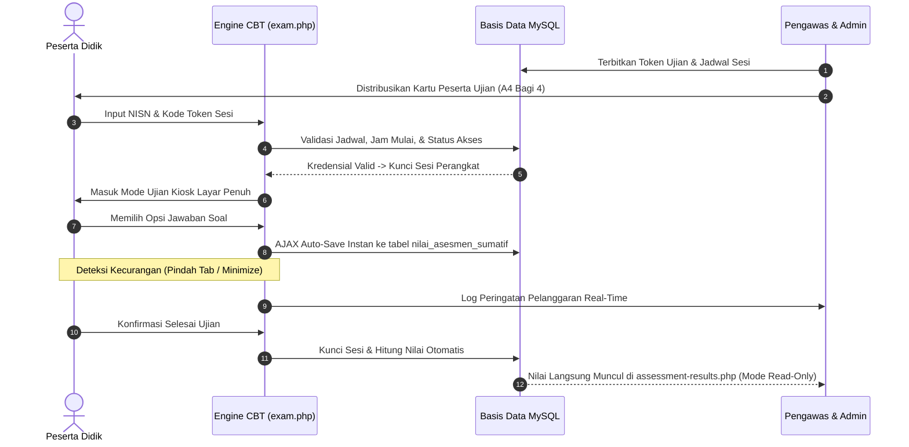
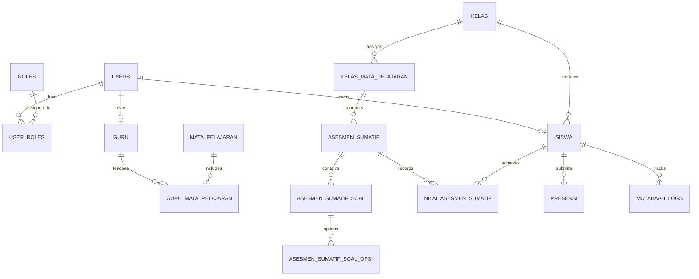

<div align="center">
  

  # 🎓 ILMUNA LEARN
  ### Sistem Informasi Akademik (SIAKAD) & Learning Management System (LMS)
  **Platform Pembelajaran Terpadu Berbasis Kurikulum Merdeka & Pendidikan Agama Islam (PAI) dengan Sentuhan Luhur Budaya Nusantara**

  <p align="center">
    
    
    
    
    
    
  </p>

  <p align="center">
    <a href="#1-profil--arsitektur-teknologi-sistem"><b>🚀 Profil & Arsitektur</b></a> •
    <a href="#2-sistem-notifikasi--dialog-global-ilmuna-ui"><b>🔔 Standar Alert & Dialog</b></a> •
    <a href="#3-design-system-tema-lumina-gold--sentuhan-nusantara"><b>🎨 Tema & Desain</b></a> •
    <a href="#4-filosofi-desain-data-first-anti-hero--anti-statistik-mubazir"><b>📊 Prinsip Data-First</b></a> •
    <a href="#5-standar-responsivitas-mobile--layar-smartphone"><b>📱 Standar Mobile</b></a> •
    <a href="#6-inventaris-lengkap-51-modul-dashboard"><b>🏛️ 51 Modul Dashboard</b></a> •
    <a href="#7-sub-sistem-utama-cbt-presensi-gps-mutabaah-e-rapor"><b>⚙️ Sub-Sistem Utama</b></a> •
    <a href="#8-skema-resmi-69-tabel-basis-data"><b>🗄️ 69 Tabel Basis Data</b></a> •
    <a href="#9-panduan-pengembang-ai-ai-assistant-blueprint--prompting-rules"><b>🤖 Panduan AI Assistant</b></a> •
    <a href="#10-panduan-instalasi-lingkungan--troubleshooting"><b>🛠️ Instalasi & Troubleshooting</b></a>
  </p>
</div>

---

<div align="center">
  <table>
    <tr>
      <td align="center" width="25%">
        <b>⚡ Eksekusi Mikrodetik</b><br>
        <sub>PHP 8.2 Native murni dengan PDO Singleton. Ringan, responsif, dan hemat memori pada server lokal maupun shared hosting cPanel.</sub>
      </td>
      <td align="center" width="25%">
        <b>🛡️ CBT Kiosk Anti-Curang</b><br>
        <sub>Lock screen, deteksi pindah tab, anti pintasan keyboard, penyimpanan jawaban real-time per butir, & cetak kartu ujian PDF 4-in-1 A4.</sub>
      </td>
      <td align="center" width="25%">
        <b>📍 Geofencing GPS & Presensi QR</b><br>
        <sub>Validasi jarak radius sekolah via koordinat satelit GPS dengan algoritma Haversine dan generator kode QR harian dinamis.</sub>
      </td>
      <td align="center" width="25%">
        <b>📖 Mutaba'ah & E-Rapor Merdeka</b><br>
        <sub>Monitoring jurnal ibadah harian (Sholat 5 waktu, Dhuha, Tahajud, Tilawah) terintegrasi ke penilaian sikap spiritual E-Rapor.</sub>
      </td>
    </tr>
  </table>
</div>

---

## DAFTAR ISI LENGKAP

1. [Profil & Arsitektur Teknologi Sistem](#1-profil--arsitektur-teknologi-sistem)
   - [1.1 Spesifikasi Inti Stack](#11-spesifikasi-inti-stack)
   - [1.2 Pohon Struktur Berkas Proyek](#12-pohon-struktur-berkas-proyek)
2. [Sistem Notifikasi & Dialog Global (Ilmuna UI)](#2-sistem-notifikasi--dialog-global-ilmuna-ui)
   - [2.1 Anatomi & Visual Nusantara Touch](#21-anatomi--visual-nusantara-touch)
   - [2.2 Larangan Keras Alert Browser & Eksternal](#22-larangan-keras-alert-browser--eksternal)
   - [2.3 Dokumentasi Method API `window.Ilmuna`](#23-dokumentasi-method-api-windowilmuna)
3. [Design System: Tema Lumina Gold & Sentuhan Nusantara](#3-design-system-tema-lumina-gold--sentuhan-nusantara)
   - [3.1 Design Tokens & Palet Warna Resmi](#31-design-tokens--palet-warna-resmi)
   - [3.2 Tipografi & Bobot Huruf](#32-tipografi--bobot-huruf)
   - [3.3 Komponen UI: Tombol, Form Input, & Badge](#33-komponen-ui-tombol-form-input--badge)
4. [Filosofi Desain "Data-First" (Anti-Hero & Anti-Statistik Mubazir)](#4-filosofi-desain-data-first-anti-hero--anti-statistik-mubazir)
   - [4.1 Definisi & Aturan Larangan Tata Letak](#41-definisi--aturan-larangan-tata-letak)
   - [4.2 Cetak Biru Standar Halaman Data](#42-cetak-biru-standar-halaman-data)
5. [Standar Responsivitas Mobile & Layar Smartphone](#5-standar-responsivitas-mobile--layar-smartphone)
   - [5.1 Breakpoint & Resolusi Layar Uji](#51-breakpoint--resolusi-layar-uji)
   - [5.2 Spesifikasi UX Mobile Wajib](#52-spesifikasi-ux-mobile-wajib)
   - [5.3 Transformasi Tabel Responsif ke Card Stack](#53-transformasi-tabel-responsif-ke-card-stack)
6. [Inventaris Lengkap 51 Modul Dashboard](#6-inventaris-lengkap-51-modul-dashboard)
   - [6.1 Modul Panel Administrator (34 Berkas PHP)](#61-modul-panel-administrator-34-berkas-php)
   - [6.2 Modul Panel Pengajar / Guru (7 Berkas PHP)](#62-modul-panel-pengajar--guru-7-berkas-php)
   - [6.3 Modul Portal Peserta Didik / Siswa (6 Berkas PHP)](#63-modul-portal-peserta-didik--siswa-6-berkas-php)
   - [6.4 Modul Panel Ketua Kelas (4 Berkas PHP)](#64-modul-panel-ketua-kelas-4-berkas-php)
7. [Sub-Sistem Utama (CBT, Presensi GPS, Mutaba'ah, E-Rapor)](#7-sub-sistem-utama-cbt-presensi-gps-mutabaah-e-rapor)
   - [7.1 Mesin CBT & Ujian Anti-Curang (`exam.php`)](#71-mesin-cbt--ujian-anti-curang-examphp)
   - [7.2 Presensi Mandiri GPS Geofencing (Formula Haversine)](#72-presensi-mandiri-gps-geofencing-formula-haversine)
   - [7.3 Mutaba'ah Yaumiyah & Pembiasaan Karakter PAI](#73-mutabaah-yaumiyah--pembiasaan-karakter-pai)
   - [7.4 E-Rapor Kurikulum Merdeka](#74-e-rapor-kurikulum-merdeka)
8. [Skema Resmi 69 Tabel Basis Data](#8-skema-resmi-69-tabel-basis-data)
9. [Panduan Pengembang AI (AI Assistant Blueprint & Prompting Rules)](#9-panduan-pengembang-ai-ai-assistant-blueprint--prompting-rules)
   - [9.1 5 Hukum Wajib AI Developer](#91-5-hukum-wajib-ai-developer)
   - [9.2 Boilerplate Lengkap Pembuatan Modul Baru](#92-boilerplate-lengkap-pembuatan-modul-baru)
10. [Panduan Instalasi Lingkungan & Troubleshooting](#10-panduan-instalasi-lingkungan--troubleshooting)

---

## 1. PROFIL & ARSITEKTUR TEKNOLOGI SISTEM

### 1.1 Spesifikasi Inti Stack
- **Server Language**: PHP 8.2 / 8.3 Native (Murni tanpa framework seperti Laravel/CodeIgniter). Seluruh *request lifecycle* diproses secara instan dengan *zero autoloading overhead*.
- **Database Abstraction**: PHP PDO (PHP Data Objects) menggunakan koneksi MySQL 8.0+ / MariaDB 10.4+ InnoDB dengan charset `utf8mb4` dan collation `utf8mb4_unicode_ci`.
- **Autentikasi & Sesi**: Enkripsi password menggunakan algoritma `PASSWORD_BCRYPT` (Cost 10+), proteksi Session Hijacking via `session_regenerate_id()`, dan Role-Based Access Control (RBAC) pada fungsi `requireRole('...')`.
- **Frontend Core**: Vanilla JavaScript ES6+ (Async/Await Fetch API), CSS3 Modern Variables, CSS Grid, Flexbox, tanpa framework frontend berat (No React, Vue, jQuery).
- **Icon Engine**: Iconify Icon Web Component (`solar:*`, `lucide:*`, `ph:*`) dimuat via script asynchronous non-blocking, dengan fallback FontAwesome 6.
- **PWA Ready**: Terpasang Service Worker (`sw.js`) dan Web App Manifest (`manifest.json`) dengan dukungan icon maskable dan caching halaman offline (`offline.html`).
- **Android Exam Browser Kiosk**: Source code native Android pada [`android-exam-browser/`](file:///c:/laragon/www/learn/android-exam-browser) untuk mengunci smartphone siswa saat ujian CBT (menonaktifkan tombol split screen, floating apps, screenshot, dan home button).
- **Headless Chromium Engine**: Menggunakan engine Google Chrome / Chromium headless modern (`--headless=new`, `--disable-gpu`, isolated temp user directory) untuk menghasilkan dokumen PDF Kartu Peserta Ujian dan Token dalam 3 detik.

### 1.2 Pohon Struktur Berkas Proyek
```text
c:\laragon\www\learn\
├── android-exam-browser/            # Source code aplikasi Android Kiosk Exam Browser (Gradle Project)
├── api/                             # Endpoint API publik & privat untuk pertukaran data JSON
├── assets/
│   ├── css/
│   │   ├── lumina-lms.css           # Stylesheet tema inti Lumina Gold LMS (Variabel, reset, tombol, layout)
│   │   ├── admin-assessment-access.css    # Style khusus modul kredensial asesmen CBT
│   │   ├── admin-assessment-questions.css # Style khusus bank soal & opsi jawaban
│   │   ├── admin-assessment-results.css   # Style khusus rekap nilai asesmen (Mode View-Only)
│   │   ├── admin-assessments.css          # Style master jadwal & pembuatan asesmen
│   │   ├── admin-classes.css              # Style manajemen rombel kelas
│   │   ├── admin-students.css             # Style manajemen data peserta didik
│   │   ├── admin-teachers.css             # Style manajemen dewan pengajar
│   │   └── admin-users.css                # Style manajemen akun portal & sandi
│   ├── js/
│   │   ├── alert.js                 # MODUL RESMI TEMPLATE DIALOG & TOAST NUSANTARA TOUCH (window.Ilmuna)
│   │   ├── admin-assessment-access.js
│   │   ├── admin-assessment-questions.js
│   │   ├── admin-assessment-results.js
│   │   └── admin-assessments.js
│   ├── images/
│   │   ├── icon.png                 # Icon aplikasi resolusi tinggi
│   │   ├── logo-learn.png           # Logo resmi Ilmuna Learn
│   │   ├── landscape-logo-learn.png # Logo horizontal tampilan banner GitHub / Kop Surat
│   │   ├── logo.ico                 # Favicon resmi
│   │   └── white logo.png           # Versi logo transparan terang
│   └── img/
│       ├── gunungan.png             # Watermark motif Gunungan Wayang Nusantara
│       └── gunungan-original.png    # Berkas master vektor Gunungan resolusi tinggi
├── config.php                       # Konfigurasi path absolut (BASE_PATH), URL (BASE_URL), dan DB
├── auth.php                         # Middleware autentikasi sesi, multi-role switch, sanitasi
├── database.php                     # Singleton koneksi PDO MySQL & fungsi pembantu database
├── gateway.php                      # Router pintu gerbang API
├── exam.php                         # Engine pelaksanaan ujian CBT siswa (Anti-Cheat Kiosk)
├── login.php                        # Autentikasi portal masuk multi-peran (Admin, Guru, Siswa, Ketua)
├── logout.php                       # Pembersihan sesi aman & pengalihan keluar
├── profile.php                      # Manajemen biodata profil pengguna, ganti foto, & ubah sandi
├── switch-role.php                  # Pengalihan hak akses multi-peran untuk pengguna ganda
├── manifest.json                    # Konfigurasi PWA (nama aplikasi, tema warna, icon display)
├── sw.js                            # Service Worker PWA untuk caching aset & penanganan offline
├── offline.html                     # Halaman fallback saat koneksi internet terputus
├── skema-tabel-kelas.sql            # Master DDL 69 tabel basis data Kurikulum Merdeka
├── includes/
│   ├── header.php                   # Template shell atas, navigasi topbar, sidebar, assets loader
│   ├── footer.php                   # Template shell bawah, script loader, inisialisasi tanggal
│   ├── sidebar.php                  # Logika pembentukan menu dinamis berbasis hak akses role
│   ├── kartu-ujian-sumatif-pdf.php  # Generator PDF Kartu Peserta Asesmen Sumatif (A4 Dibagi 4)
│   └── daftar-token-asesmen-pdf.php # Generator PDF Lembar Rekap Token Asesmen per Ruang
└── dashboard/                       # Direktori antarmuka operasional 4 peran
    ├── admin/                       # 34 berkas modul pengelola SIAKAD & LMS
    ├── guru/                        # 7 berkas modul pengajar
    ├── siswa/                       # 6 berkas portal peserta didik
    └── ketua-kelas/                 # 4 berkas panel ketua rombel
```

---

## 2. SISTEM NOTIFIKASI & DIALOG GLOBAL (ILMUNA UI)

> [!IMPORTANT]
> **ATURAN MUTLAK SISTEM ALERT & MODAL:**
> 1. Dilarang menggunakan fungsi JavaScript bawaan peramban: `alert()`, `confirm()`, atau `prompt()`.
> 2. Dilarang mengimpor atau menyisipkan pustaka dialog eksternal pihak ketiga (seperti SweetAlert, SweetAlert2, Toastr, Bootstrap Modal, Noty).
> 3. Seluruh dialog peringatan, konfirmasi penghapusan, pesan sukses, pesan galat, dan dialog keluar akun **WAJIB** menggunakan modul:
>    **[`assets/js/alert.js`](file:///c:/laragon/www/learn/assets/js/alert.js)** melalui objek global **`window.Ilmuna`**.

### 2.1 Anatomi & Visual Nusantara Touch
Template notifikasi `alert.js` dirancang khusus dengan perpaduan keindahan estetika budaya Indonesia:
- **Watermark Gunungan Wayang**: Menampilkan siluet Gunungan Wayang Jawa samar (`opacity: 0.08` pada modal, `0.1` pada toast) di pojok kanan bawah setiap kotak pesan.
- **Ornamen Sudut Batik Klasik**: Vektor SVG batik tajam pada sudut kiri atas (`ORNAMENT_TL`), kanan atas (`ORNAMENT_TR`), dan kiri bawah (`ORNAMENT_BL`).
- **Tekstur Latar Belakang Batik Kawung**: Pola geometris lingkaran berulang khas Batik Kawung dengan opasitas 3% yang lembut di latar putih.
- **Bentuk Geometri Asimetris**: Lengkungan sudut modern `border-radius: 32px 0 16px 0`.
- **CSS Terisolasi**: Semua kelas CSS menggunakan prefix unik `.ilm-ui-*` sehingga 100% bebas dari benturan style CSS lain.

### 2.2 Larangan Keras Alert Browser & Eksternal
```javascript
// ❌ DILARANG KERAS:
alert('Data tersimpan');
if (confirm('Yakin ingin menghapus?')) { ... }
Swal.fire('Sukses', 'Data tersimpan', 'success'); // Dilarang SweetAlert!

// ✅ WAJIB MENGGUNAKAN ILMUNA UI:
Ilmuna.toast('success', 'Berhasil Disimpan', 'Data siswa berhasil diperbarui ke basis data.');
const setuju = await Ilmuna.confirm('error', 'Hapus Data?', 'Data tidak dapat dipulihkan.');
if (setuju) { ... }
```

### 2.3 Dokumentasi Method API `window.Ilmuna`

#### A. Notifikasi Toast Mengambang (`Ilmuna.toast`)
Toast notifikasi mengambang di pojok kanan atas layar dengan ikon vektor dan garis aksen warna tema:
```javascript
/**
 * Menampilkan notifikasi toast mengambang
 * @param {string} type - 'success' | 'info' | 'warning' | 'error'
 * @param {string} title - Judul ringkas notifikasi
 * @param {string} message - Pesan penjelasan
 * @param {number} [duration=4000] - Durasi tampil (milidetik). Berikan 0 jika ingin sticky (tidak otomatis tertutup)
 */
Ilmuna.toast(type, title, message, duration);

// Contoh Penggunaan:
Ilmuna.toast('success', 'Berhasil', 'Data berhasil diperbarui!');
Ilmuna.toast('error', 'Koneksi Terputus', 'Gagal menyambung ke server.', 0); // Sticky

// Shortcut Helper:
Ilmuna.success('Berhasil', 'Nilai asesmen siswa berhasil direkap!');
Ilmuna.info('Informasi', 'Sesi ujian sumatif dimulai pukul 08:00 WIB.');
Ilmuna.warning('Perhatian', 'Batas unggah tugas tersisa 30 menit.');
Ilmuna.error('Gagal', 'Format berkas Excel tidak valid.');
```

#### B. Modal Dialog Konfirmasi (`Ilmuna.confirm` & `Ilmuna.alert`)
Dialog interaktif berlatar belakang kabur (*backdrop blur*) untuk keputusan sistem yang penting:
```javascript
/**
 * 1. Dialog Konfirmasi Berbasis Promise (Modern Async / Await) — SANGAT DISARANKAN
 * @param {string} type - 'success' | 'info' | 'warning' | 'error' | 'logout'
 * @param {string} title - Judul modal konfirmasi
 * @param {string} message - Pertanyaan / penjelasan dampak aksi
 * @param {string} [confirmText='Ya, Lanjutkan'] - Label tombol konfirmasi
 * @param {string} [cancelText='Batal'] - Label tombol batal
 * @returns {Promise<boolean>} - Mengembalikan true jika diklik konfirmasi, false jika batal
 */
async function hapusDataSiswa(id) {
    const yakin = await Ilmuna.confirm(
        'error',
        'Hapus Data Siswa?',
        'Data siswa, nilai, dan akun login akan dihapus permanen dari basis data.',
        'Ya, Hapus Data!',
        'Batalkan'
    );
    
    if (!yakin) return; // Pengguna menekan tombol Batal atau Escape

    // Lanjutkan eksekusi fetch...
}

/**
 * 2. Dialog Modal Klasik Callback
 * @param {string} type
 * @param {string} title
 * @param {string} message
 * @param {string} [confirmText='OK']
 * @param {boolean} [showCancel=false]
 * @param {Function} [onConfirm]
 * @param {Function} [onCancel]
 * @param {string} [cancelText='Batal']
 */
Ilmuna.alert('info', 'Pembaruan Kurikulum', 'Versi Capaian Pembelajaran Fase E telah diperbarui.', 'Mengerti');
```

#### C. Dialog Konfirmasi Logout Akun (`Ilmuna.logout`)
Fitur keluar sesi yang seragam di seluruh peran:
```javascript
// Pemanggilan via JavaScript murni:
Ilmuna.logout(); // Menuju BASE_URL/logout.php secara default

// Opsi pemanggilan kustom:
Ilmuna.logout({
    url: '/auth/logout.php',
    title: 'Keluar dari Sesi?',
    message: 'Pastikan seluruh nilai dan tugas sudah Anda simpan sebelum keluar.',
    confirmText: 'Ya, Keluar Akun',
    cancelText: 'Tetap di Sini'
});

// Auto-binding pada elemen HTML tanpa perlu membuat fungsi JavaScript manual:
<a href="/logout.php" data-ilm-logout>Keluar Akun</a>
<button type="button" data-ilm-logout>Keluar</button>
```

---

## 3. DESIGN SYSTEM: TEMA LUMINA GOLD & SENTUHAN NUSANTARA

Tema **Lumina Gold LMS** menggabungkan standar antarmuka SaaS modern dengan kehangatan ornamen warisan Nusantara.

### 3.1 Design Tokens & Palet Warna Resmi
```css
:root {
    /* Brand Primary Colors */
    --lumina-navy:         #1D3B5E; /* Hex utama: Brand authority, teks judul, border header */
    --lumina-navy-rgb:     29, 59, 94;
    --lumina-teal:         #0D7A87; /* Aksen tombol utama, active link, badge highlight */
    --lumina-teal-rgb:     13, 122, 135;
    --lumina-sky:          #52B2DC; /* Aksen interaktif, fokus input, badge sekunder */
    --lumina-sky-rgb:      82, 178, 220;
    --lumina-gold:         #F59E0B; /* Elemen prestisius, koin gamifikasi, token, bintang */
    --lumina-gold-rgb:     245, 158, 11;

    /* Semantic Functional Colors */
    --lumina-emerald:      #10B981; /* Sukses, status aktif, presensi tepat waktu */
    --lumina-emerald-rgb:  16, 185, 129;
    --lumina-amber:        #D97706; /* Peringatan, remedial, status terlambat */
    --lumina-rose:         #EF4444; /* Bahaya, hapus data, terkunci, status alpa */
    --lumina-rose-rgb:     239, 68, 68;

    /* Canvas & Surfaces */
    --lumina-bg-canvas:    #F8FAFC; /* Latar kanvas halaman sejuk dan bersih */
    --lumina-bg-card:      #FFFFFF; /* Permukaan kartu data dan modal */
    --lumina-bg-sidebar:   rgba(255, 255, 255, 0.96);
    --lumina-border:       #E2E8F0; /* Garis batas netral */
    --lumina-border-focus: rgba(13, 122, 135, 0.4);

    /* Rounded Corner Tokens */
    --radius-sm:           8px;
    --radius-md:           12px;
    --radius-lg:           18px;
    --radius-full:         9999px;

    /* Shadows & Elevation */
    --shadow-sm:           0 2px 6px rgba(29, 59, 94, 0.04);
    --shadow-md:           0 8px 20px -4px rgba(29, 59, 94, 0.08);
    --shadow-lg:           0 16px 32px -8px rgba(13, 122, 135, 0.12);
}
```

### 3.2 Tipografi & Bobot Huruf
- **Headings (`h1`, `h2`, `h3`, `h4`, `h5`)**: Menggunakan font Google `'Outfit', sans-serif` dengan bobot 600 (Semi-Bold), 700 (Bold), dan 800 (Extra-Bold).
- **Body & Form Text**: Menggunakan font Google `'Plus Jakarta Sans', sans-serif` dengan bobot 400 (Regular), 500 (Medium), dan 600 (Semi-Bold).
- **Kode Token & Sandi**: Menggunakan font monospace `'JetBrains Mono', 'Fira Code', Consolas, monospace`.

### 3.3 Komponen UI: Tombol, Form Input, & Badge
```html
<!-- Tombol Standar -->
<button class="btn btn-primary"><iconify-icon icon="solar:disk-bold"></iconify-icon> Simpan Data</button>
<button class="btn btn-gold"><iconify-icon icon="solar:key-bold"></iconify-icon> Buat Token</button>
<button class="btn btn-outline"><iconify-icon icon="solar:refresh-bold"></iconify-icon> Reset</button>
<button class="btn btn-danger"><iconify-icon icon="solar:trash-bin-trash-bold"></iconify-icon> Hapus</button>

<!-- Badges Status -->
<span class="ilmuna-badge ilmuna-badge--success">Aktif</span>
<span class="ilmuna-badge ilmuna-badge--warning">Sedang Mengerjakan</span>
<span class="ilmuna-badge ilmuna-badge--danger">Terkunci</span>
<span class="ilmuna-badge ilmuna-badge--info">Fase E</span>
```

---

## 4. FILOSOFI DESAIN "DATA-FIRST" (ANTI-HERO & ANTI-STATISTIK MUBAZIR)

> [!WARNING]
> **ATURAN MUTLAK TATA LETAK HALAMAN DATA:**
> Pada seluruh sub-halaman dashboard (Data Siswa, Data Guru, Data Kelas, Jadwal, Kurikulum, Asesmen, Presensi, Mutabaah, Nilai, dll.):
> 
> 1. **DILARANG MEMASANG BANNER HERO**: Jangan memasang banner dekoratif raksasa, ucapan "Selamat Datang...", poster bergambar kartun/vektor besar, atau ilustrasi header yang memakan tinggi layar vertikal 150px–300px.
> 2. **DILARANG MENAMPILKAN WIDGET STATISTIK BERLEBIHAN**: Jangan memasang deretan 4–6 kotak metrik KPI (seperti Total Siswa, Siswa Aktif, Siswa Izin, dll.) di atas tabel data yang menenggelamkan data utama ke bawah layar. Statistik hanya diperbolehkan pada halaman Beranda Ringkasan Utama (`index.php`) masing-masing peran secara proporsional.
> 3. **LANGSUNG TAMPILKAN DATA (DATA-FIRST)**: Pengguna membuka halaman manajemen untuk bekerja dengan data, bukan membaca banner dekoratif. Begitu halaman dibuka, pengguna harus langsung melihat: **Header Ringkas 1 Baris -> Toolbar Filter & Pencarian -> Tabel / Grid Data Utama**.

### 4.1 Definisi & Aturan Larangan Tata Letak


### 4.2 Cetak Biru Standar Halaman Data
```html
<!-- 1. HEADER RINGKAS (1 Baris, tinggi maks 56px) -->
<div class="ilmuna-page-header">
    <div class="ilmuna-page-header__left">
        <div class="ilmuna-page-icon">
            <iconify-icon icon="solar:users-group-rounded-bold" width="22"></iconify-icon>
        </div>
        <div>
            <h1 class="ilmuna-page-title">Manajemen Data Siswa</h1>
            <p class="ilmuna-page-subtitle">Kelola master peserta didik, rombel kelas, dan akun portal</p>
        </div>
    </div>
    <div class="ilmuna-page-header__actions">
        <button type="button" class="btn btn-outline" id="btnExport">
            <iconify-icon icon="solar:file-download-bold"></iconify-icon> Ekspor Excel
        </button>
        <button type="button" class="btn btn-primary" id="btnTambah">
            <iconify-icon icon="solar:add-circle-bold"></iconify-icon> Tambah Siswa
        </button>
    </div>
</div>

<!-- 2. TOOLBAR FILTER CEPAT & LIVE SEARCH -->
<div class="ilmuna-toolbar">
    <div class="ilmuna-toolbar__filters">
        <div class="ilmuna-filter-group">
            <label for="filterKelas">Rombel:</label>
            <select id="filterKelas" class="ilmuna-select">
                <option value="0">— Semua Kelas —</option>
            </select>
        </div>
        <div class="ilmuna-search-group">
            <iconify-icon icon="solar:magnifer-linear"></iconify-icon>
            <input type="text" id="searchInput" placeholder="Cari NISN, nama lengkap, WhatsApp..." autocomplete="off">
        </div>
    </div>
</div>

<!-- 3. DATA CONTAINER (TABEL / GRID DATA FOKUS UTAMA) -->
<div class="ilmuna-card">
    <div class="table-responsive">
        <table class="ilmuna-table" id="dataTable">
            <thead>
                <tr>
                    <th width="40">No</th>
                    <th>Nama Lengkap</th>
                    <th>NISN / NIS</th>
                    <th>Kelas</th>
                    <th>Status</th>
                    <th width="120" class="text-center">Aksi</th>
                </tr>
            </thead>
            <tbody id="tableBody">
                <!-- Baris Data Dimuat Langsung -->
            </tbody>
        </table>
    </div>
    <!-- 4. PAGINASI RINGKAS -->
    <div class="ilmuna-pagination-wrap" id="paginationWrap"></div>
</div>
```

---

## 5. STANDAR RESPONSIVITAS MOBILE & LAYAR SMARTPHONE

Ilmuna Learn digunakan secara masif melalui ponsel pintar (smartphone Android entry-level hingga iPhone Pro Max). Tampilan mobile diperlakukan sebagai warga negara kelas satu (*first-class citizen*).

### 5.1 Breakpoint & Resolusi Layar Uji
- **Ponsel Kecil**: `360px – 380px` (Samsung Galaxy A-series, Xiaomi Redmi entry).
- **Ponsel Standar**: `390px – 414px` (iPhone 13/14/15, Google Pixel, Galaxy S-series).
- **Ponsel Pro / Max**: `428px – 440px` (iPhone Pro Max, Samsung Ultra).
- **Tablet**: `768px – 1024px` (iPad, Galaxy Tab).
- **Desktop**: `> 1024px` (Monitor Laptop & PC).

### 5.2 Spesifikasi UX Mobile Wajib
1. **Zero Horizontal Overflow (`overflow-x: hidden`)**:
   Halaman tidak boleh mengalami goyang ke samping atau menampilkan celah putih horizontal yang tidak disengaja.
2. **Ukuran Target Sentuh (Touch Target Size) Minimum 44px x 44px**:
   Semua tombol aksi, tombol ikon, dropdown, checkbox, dan tautan menu wajib memiliki luas sentuh minimal 44 piksel agar mudah dijangkau dengan jempol satu tangan.
3. **Penskalaan Tipografi Proporsional**:
   - Judul Halaman (`h1`): Di desktop `1.75rem`, di mobile otomatis mengecil ke `1.25rem - 1.35rem`.
   - Teks Form Input: Minimum `15px - 16px` untuk mencegah efek *auto-zoom* peramban iOS Safari.
   - Teks Tabel/Card: `12.5px - 13.5px` dengan kontras keterbacaan tinggi (WCAG AA).
4. **Bottom Dock Navigation (Navigasi Bawah Jempol)**:
   Pada resolusi mobile (`<= 768px`), sidebar desktop secara otomatis disembunyikan dan digantikan oleh bilah navigasi bawah (*Bottom Navigation Dock*) yang memperhitungkan `env(safe-area-inset-bottom)`.

### 5.3 Transformasi Tabel Responsif ke Card Stack
Pada perangkat smartphone, tabel data yang memiliki banyak kolom dapat ditransformasikan menjadi tampilan kartu vertikal (*Card Stack*) agar tidak terpotong:
```css
@media (max-width: 768px) {
    /* Stack Filter Toolbar Secara Vertikal */
    .ilmuna-toolbar__filters {
        flex-direction: column;
        align-items: stretch;
        gap: 10px;
    }
    .ilmuna-filter-group, .ilmuna-search-group {
        width: 100% !important;
    }
    .ilmuna-search-group input {
        width: 100% !important;
        font-size: 15px !important;
        min-height: 44px;
    }

    /* Transformasi Tabel Menjadi Card di Layar Sangat Kecil (Opsional) */
    .ilmuna-table-stack thead { display: none; }
    .ilmuna-table-stack tbody tr {
        display: block;
        background: #ffffff;
        border: 1px solid var(--lumina-border);
        border-radius: 14px;
        padding: 14px;
        margin-bottom: 12px;
        box-shadow: var(--shadow-sm);
    }
    .ilmuna-table-stack tbody td {
        display: flex;
        justify-content: space-between;
        align-items: center;
        padding: 8px 0;
        border-bottom: 1px solid #f1f5f9;
    }
    .ilmuna-table-stack tbody td:last-child {
        border-bottom: none;
        padding-top: 12px;
        justify-content: flex-end;
    }
    .ilmuna-table-stack tbody td::before {
        content: attr(data-label);
        font-weight: 700;
        font-size: 12px;
        color: var(--lumina-navy);
        text-transform: uppercase;
    }
}
```

---

## 6. INVENTARIS LENGKAP 51 MODUL DASHBOARD

Berikut adalah rincian lengkap 51 berkas modul PHP yang menyusun antarmuka 4 peran pengguna di Ilmuna Learn:

### 6.1 Modul Panel Administrator (34 Berkas PHP)
| No | Nama Berkas di `dashboard/admin/` | Fungsi & Fungsionalitas Lengkap |
| :-: | :--- | :--- |
| 1 | `index.php` | Beranda ringkasan eksekutif, status server, pintasan akses cepat CBT, Presensi, Geofencing, dan Siswa. |
| 2 | `identitas-sekolah.php` | Pengaturan identitas resmi sekolah: nama madrasah/sekolah, NPSN, akreditasi, alamat, logo, dan kop surat. |
| 3 | `school-profile.php` | Profil lengkap sekolah untuk transkrip E-Rapor dan dokumen cetak. |
| 4 | `curriculum.php` | Master Kurikulum Merdeka: Fase fondasi/A/B/C/D/E/F, Capaian Pembelajaran (CP), Tujuan Pembelajaran (TP). |
| 5 | `classes.php` | Manajemen rombel kelas: tingkat kelas (7-12), jurusan, kapasitas kursi, dan penugasan wali kelas. |
| 6 | `classes-excel.php` | Generator ekspor data rombongan belajar ke format spreadsheet Excel (.xlsx). |
| 7 | `teachers.php` | Master data dewan guru & staf pengajar: NIP, NUPTK, jabatan, mapel yang diampu, dan aktivasi akun portal. |
| 8 | `teachers-excel.php` | Generator ekspor master data dewan guru ke format spreadsheet Excel (.xlsx). |
| 9 | `students.php` | Master data peserta didik: NISN, NIS, nama lengkap, kontak WhatsApp wali, foto profil, dan impor Excel. |
| 10 | `students-excel.php` | Generator ekspor dan template impor data siswa format Excel (.xlsx). |
| 11 | `subjects.php` | Master mata pelajaran PAI (Al-Qur'an Hadits, Akidah Akhlak, Fikih, SKI) dan mata pelajaran umum. |
| 12 | `subjects-excel.php` | Generator ekspor daftar mata pelajaran ke format Excel (.xlsx). |
| 13 | `schedules.php` | Manajemen jadwal pelajaran mingguan per kelas, alokasi jam tatap muka, dan penentuan ruang kelas. |
| 14 | `attendance.php` | Rekap kehadiran siswa harian per rombel dan per mata pelajaran. |
| 15 | `attendance-excel.php` | Generator ekspor rekap presensi kehadiran siswa ke format Excel (.xlsx). |
| 16 | `presensi-master.php` | Pusat kendali presensi: aktivasi presensi harian, pembuatan token presensi, dan generator kode QR dinamis. |
| 17 | `presensi-token-excel.php` | Generator ekspor lembar rekap token presensi ke format Excel (.xlsx). |
| 18 | `geofencing.php` | Manajemen titik koordinat GPS gerbang sekolah (Latitude, Longitude, Radius toleransi meter) untuk presensi mandiri. |
| 19 | `materials.php` | Pemantauan materi pembelajaran digital yang diunggah dewan guru di seluruh kelas. |
| 20 | `assignments.php` | Pemantauan tugas siswa, tenggat waktu pengumpulan, dan status penilaian guru. |
| 21 | `assessments.php` | Master asesmen: pembuatan jadwal asesmen formatif, sumatif, diagnostik, dan remedial. |
| 22 | `assessments-excel.php` | Generator ekspor daftar asesmen ke format spreadsheet Excel (.xlsx). |
| 23 | `assessment-questions.php` | Bank Soal CBT: butir soal pilihan ganda, esai, rubrik nilai, pembobotan, dan penyisipan media gambar/audio. |
| 24 | `assessment-access.php` | Kredensial Ujian CBT: penerbitan token sesi, pemantauan status siswa aktif, reset sesi ujian, & cetak kartu. |
| 25 | `assessment-results.php` | Rekap hasil nilai asesmen dan analisis butir soal (Mode View-Only aman terproteksi dari suntingan liar). |
| 26 | `absensi-sumatif.php` | Berita acara dan daftar hadir ruang pelaksanaan asesmen sumatif resmi. |
| 27 | `mutabaah.php` | Monitoring jurnal ibadah yaumiyah seluruh peserta didik (shalat fardhu, dhuha, tahajud, tilawah Al-Qur'an). |
| 28 | `reports.php` | Pengelolaan E-Rapor Kurikulum Merdeka: cetak nilai capaian kompetensi, transkrip, dan buku rapor. |
| 29 | `reports-excel.php` | Generator ekspor rekap nilai E-Rapor ke format Excel (.xlsx). |
| 30 | `reports-pdf.php` | Generator cetak buku E-Rapor format PDF resmi dengan kop sekolah dan tanda tangan kepala sekolah. |
| 31 | `kaldik-excel.php` | Generator kalender akademik pendidikan format spreadsheet Excel (.xlsx). |
| 32 | `kaldik-pdf.php` | Generator cetak kalender akademik format PDF berwarna. |
| 33 | `users.php` | Manajemen akun sistem: hak akses role (admin, guru, siswa, ketua kelas), aktivasi status, dan reset sandi. |
| 34 | `users-email-template.php` | Pengelola templat pesan email aktivasi dan notifikasi kredensial pengguna baru. |

### 6.2 Modul Panel Pengajar / Guru (7 Berkas PHP)
| No | Nama Berkas di `dashboard/guru/` | Fungsi & Fungsionalitas Lengkap |
| :-: | :--- | :--- |
| 35 | `index.php` | Beranda guru: jadwal mengajar hari ini, tugas siswa yang belum dinilai, dan statistik mengajar. |
| 36 | `absensi.php` | Input presensi kehadiran siswa di kelas per jam pelajaran (Hadir, Izin, Sakit, Alpa). |
| 37 | `scan-qr.php` | Scanner kamera web/ponsel guru untuk memindai kartu QR Code peserta didik di ruang kelas. |
| 38 | `materi.php` | Pengunggahan dan pengelolaan modul bahan ajar, dokumen PDF, tautan YouTube, dan ringkasan materi. |
| 39 | `tugas.php` | Pembuatan tugas kelas, panduan pengerjaan, tenggat waktu, dan pengoreksian tugas siswa. |
| 40 | `absensi-sumatif.php` | Pengawasan ruang asesmen sumatif resmi dan verifikasi kehadiran fisik peserta ujian. |
| 41 | `reports.php` | Penginputan nilai capaian TP (Tujuan Pembelajaran) dan perumusan deskripsi capaian rapor Kurikulum Merdeka. |

### 6.3 Modul Portal Peserta Didik / Siswa (6 Berkas PHP)
| No | Nama Berkas di `dashboard/siswa/` | Fungsi & Fungsionalitas Lengkap |
| :-: | :--- | :--- |
| 42 | `index.php` | Beranda siswa: jadwal kelas aktif, koin prestasi, pengumuman sekolah, dan daftar tugas mendatang. |
| 43 | `absensi.php` | Presensi mandiri berbasis validasi GPS Geofencing radius sekolah dari perangkat ponsel siswa. |
| 44 | `materi.php` | Akses dan unduh bahan ajar serta modul pembelajaran digital dari dewan guru. |
| 45 | `tugas.php` | Daftar penugasan kelas, instruksi guru, dan formulir pengunggahan berkas jawaban tugas (PDF/Foto). |
| 46 | `mutabaah.php` | Jurnal amalan yaumiyah harian: Sholat 5 waktu, Dhuha, Tahajud, Tadarus Juz 'Amma, dan Puasa Sunnah. |
| 47 | `nilai.php` | Transkrip capaian kompetensi siswa, riwayat nilai tugas, nilai formatif, nilai sumatif, dan rekap rapor. |

### 6.4 Modul Panel Ketua Kelas (4 Berkas PHP)
| No | Nama Berkas di `dashboard/ketua-kelas/` | Fungsi & Fungsionalitas Lengkap |
| :-: | :--- | :--- |
| 48 | `index.php` | Beranda operasional ketua rombel: agenda kelas hari ini dan status piket kebersihan. |
| 49 | `agenda.php` | Pengisian jurnal harian kelas: materi yang diajarkan, guru yang hadir, guru berhalangan, dan guru piket. |
| 50 | `presensi.php` | Pengecekan daftar hadir harian rekan-rekan sekelas untuk diserahkan ke wali kelas. |
| 51 | `monitoring.php` | Pemantauan tugas rombel: melihat daftar nama teman sekelas yang belum mengumpulkan tugas. |

---

## 7. SUB-SISTEM UTAMA (CBT, PRESENSI GPS, MUTABA'AH, E-RAPOR)

### 7.1 Mesin CBT & Ujian Anti-Curang (`exam.php`)


- **Mekanisme Kiosk Exam**:
  - Deteksi event `visibilitychange`: Jika siswa beralih ke aplikasi lain (seperti WhatsApp, browser pencarian), sistem mencatat log pelanggaran dan menampilkan peringatan bertingkat.
  - Penonaktifan tombol pintas keyboard: Memblokir `F12` (DevTools), `Ctrl+U` (View Source), `Ctrl+C` (Salin), `Ctrl+V` (Tempel), dan klik kanan context menu.
- **Penyimpanan Real-Time Per Butir**: Setiap klik opsi pilihan ganda atau input esai langsung disimpan ke database via *background fetch*. Tidak ada data hilang jika perangkat mati mendadak.
- **Pencetakan Kartu Ujian 4-in-1**: Berkas [`includes/kartu-ujian-sumatif-pdf.php`](file:///c:/laragon/www/learn/includes/kartu-ujian-sumatif-pdf.php) menghasilkan lembar A4 berisi 4 kartu ujian peserta lengkap dengan barcode, logo sekolah, jadwal ujian, dan tanda tangan kepala sekolah via engine Chromium.

### 7.2 Presensi Mandiri GPS Geofencing (Formula Haversine)
Presensi mandiri siswa diverifikasi di sisi server menggunakan rumus matematika Haversine untuk menghitung jarak lingkaran besar antara koordinat satelit GPS perangkat siswa dengan koordinat gerbang sekolah:
$$\Delta\text{lat} = \text{lat}_2 - \text{lat}_1, \quad \Delta\text{lon} = \text{lon}_2 - \text{lon}_1$$
$$a = \sin^2\left(\frac{\Delta\text{lat}}{2}\right) + \cos(\text{lat}_1)\cos(\text{lat}_2)\sin^2\left(\frac{\Delta\text{lon}}{2}\right)$$
$$d = 2 R \cdot \arcsin(\sqrt{a})$$
*(di mana $R = 6.371.000$ meter)*. Jika jarak $d$ melebihi radius batas toleransi (misalnya 100 meter), permohonan presensi ditolak dengan notifikasi dialog `window.Ilmuna`.

### 7.3 Mutaba'ah Yaumiyah & Pembiasaan Karakter PAI
- Mencatat kepatuhan amalan harian: Sholat Shubuh, Dzuhur, Ashar, Maghrib, Isya' berjamaah, Sholat Dhuha, Sholat Tahajud, Tadarus Al-Qur'an (Juz & Ayat), Dzikir, dan Berbakti kepada Orang Tua.
- Rekap bulanan menghasilkan persentase skor spiritualitas yang langsung disinkronkan ke dalam deskripsi nilai Sikap Spiritual E-Rapor Kurikulum Merdeka.

### 7.4 E-Rapor Kurikulum Merdeka
- Penilaian berbasis **Tujuan Pembelajaran (TP)** dan **Capaian Pembelajaran (CP)**.
- Otomatisasi pembentukan deskripsi narasi rapor: mengidentifikasi TP tertinggi yang dicapai siswa dengan sangat baik dan TP yang masih membutuhkan bimbingan lebih lanjut.
- Cetak lembar rapor resmi per siswa dengan format PDF standar Kemendikbudristek / Kemenag.

---

## 8. SKEMA RESMI 69 TABEL BASIS DATA

Sistem Ilmuna Learn didukung oleh **69 tabel resmi** InnoDB (MySQL 8 / MariaDB) yang terorganisasi ke dalam 10 kelompok relasi:



### Rincian 69 Tabel Sistem:
1. **Autentikasi & Pengguna**: `users`, `roles`, `user_roles`.
2. **Master Lembaga & Civitas**: `identitas_sekolah`, `kelas`, `siswa`, `guru`, `mata_pelajaran`, `guru_mata_pelajaran`, `kelas_mata_pelajaran`.
3. **Struktur Kurikulum Merdeka**: `elemen`, `cp` (Capaian Pembelajaran), `tp` (Tujuan Pembelajaran), `atp` (Alur Tujuan Pembelajaran), `itp`, `model_pembelajaran`, `sintaks_model_pembelajaran`, `metode_pembelajaran`, `materi`, `modul_ajar`.
4. **Kalender Akademik & Alokasi Beban**: `pekan_efektif`, `hari_efektif`, `alokasi_hari_mengajar`, `distribusi_jtm_tp`, `prota`, `prota_detail`, `prosem`, `prosem_detail`, `prosem_jadwal_mingguan`, `jadwal_pelajaran`.
5. **Presensi & Geofencing**: `titik_koordinat_sekolah`, `presensi`, `perizinan`, `absensi`.
6. **Tugas & Lembar Kerja (LKPD)**: `tugas`, `tugas_kelompok`, `tugas_kelompok_anggota`, `pengumpulan_tugas`, `nilai_tugas`, `lkpd`, `lkpd_soal`, `lkpd_soal_opsi`, `lkpd_soal_rubrik`, `nilai_lkpd`.
7. **Asesmen Diagnostik**: `asesmen_diagnostik`, `asesmen_diagnostik_soal`, `asesmen_diagnostik_soal_opsi`, `asesmen_diagnostik_soal_rubrik`, `nilai_asesmen_diagnostik`.
8. **Asesmen Formatif**: `asesmen_formatif`, `asesmen_formatif_soal`, `asesmen_formatif_soal_opsi`, `asesmen_formatif_soal_rubrik`, `akses_asesmen_formatif`, `nilai_asesmen_formatif`.
9. **Asesmen Sumatif & CBT**: `asesmen_sumatif`, `asesmen_sumatif_kelas`, `asesmen_sumatif_soal`, `asesmen_sumatif_soal_opsi`, `asesmen_sumatif_soal_rubrik`, `akses_asesmen_sumatif`, `absensi_asesmen_sumatif`, `nilai_asesmen_sumatif`.
10. **Remedial, Pengayaan & Rapor**: `pengayaan_remedial`, `pengayaan_remedial_soal`, `pengayaan_remedial_soal_opsi`, `pengayaan_remedial_soal_rubrik`, `nilai_pengayaan_remedial`, `akses_pengayaan_remedial`, `rekap_nilai_siswa_mapel`, `proyek`, `proyek_anggota`, `mutabaah_logs`.

---

## 9. PANDUAN PENGEMBANG AI (AI ASSISTANT BLUEPRINT & PROMPTING RULES)

> [!IMPORTANT]
> **5 HUKUM MUTLAK BAGI ASISTEN AI (GEMINI / ANTIGRAVITY / CLAUDE / GPT):**
> Saat menerima perintah untuk mengembangkan fitur baru, menyunting modul, atau memperbaiki bug:

### 9.1 5 Hukum Wajib AI Developer
1. **HUKUM 1 (DIALOG & NOTIFIKASI)**:
   Wajib menggunakan `window.Ilmuna` dari `assets/js/alert.js`. Jangan menulis `alert()`, `confirm()`, atau memasukkan SweetAlert pihak ketiga!
2. **HUKUM 2 (TATA LETAK DATA-FIRST)**:
   Dilarang menambahkan banner hero atau deretan 4 kotak statistik di atas tabel data! Langsung sajikan: **Header Ringkas 1 Baris -> Toolbar Filter & Pencarian -> Tabel / Grid Data**.
3. **HUKUM 3 (RESPONSIVITAS SMARTPHONE)**:
   Wajib memastikan antarmuka tidak mengalami *horizontal scrollbar* pada viewport 360px–430px. Tombol aksi dan form input minimal tinggi sentuh 44px.
4. **HUKUM 4 (KEAMANAN SQL PREPARED STATEMENTS)**:
   Wajib menggunakan prepared statements PDO MySQL dengan parameter binding. Dilarang melakukan konkatenasi variabel langsung ke query string.
5. **HUKUM 5 (STANDAR FORMAT RESPON JSON)**:
   Seluruh endpoint AJAX / POST wajib mengembalikan format respon JSON seragam:
   ```json
   {
       "success": true,
       "message": "Pesan keberhasilan yang ramah pengguna",
       "data": { }
   }
   ```

### 9.2 Boilerplate Lengkap Pembuatan Modul Baru
Gunakan cetak biru kode berikut saat membuat modul baru di Ilmuna Learn:

```php
<?php
/**
 * ==============================================================================
 * ILMUNA LEARN — MODUL CONTOH STANDAR (DATA-FIRST & MOBILE-FIRST)
 * ==============================================================================
 */
require_once __DIR__ . '/../../config.php';
require_once __DIR__ . '/../../auth.php';

// 1. Otorisasi Hak Akses Role
requireRole('admin');

// 2. Handler AJAX / Backend API
if (isset($_GET['ajax']) && $_GET['ajax'] === '1') {
    header('Content-Type: application/json; charset=utf-8');
    try {
        $stmt = $pdo->prepare("SELECT id, nama_lengkap, nisn FROM siswa WHERE status_siswa = 'Aktif' ORDER BY id DESC LIMIT 50");
        $stmt->execute();
        $rows = $stmt->fetchAll(PDO::FETCH_ASSOC);

        echo json_encode([
            'success' => true,
            'message' => 'Data berhasil dimuat',
            'data'    => $rows
        ]);
    } catch (Throwable $e) {
        http_response_code(500);
        echo json_encode([
            'success' => false,
            'message' => 'Galat server: ' . $e->getMessage()
        ]);
    }
    exit;
}

// 3. Metadata Tampilan Halaman
$pageTitle = 'Master Data Contoh';
$pageIcon  = 'solar:layers-bold';

require_once BASE_PATH . '/includes/header.php';
?>

<!-- 4. HEADER RINGKAS DATA-FIRST (TANPA HERO BANNER) -->
<div class="ilmuna-page-header">
    <div class="ilmuna-page-header__left">
        <div class="ilmuna-page-icon">
            <iconify-icon icon="solar:layers-bold" width="22"></iconify-icon>
        </div>
        <div>
            <h1 class="ilmuna-page-title">Master Data Contoh</h1>
            <p class="ilmuna-page-subtitle">Kelola master data tanpa elemen dekoratif berlebih</p>
        </div>
    </div>
    <div class="ilmuna-page-header__actions">
        <button type="button" class="btn btn-primary" id="btnTambah">
            <iconify-icon icon="solar:add-circle-bold"></iconify-icon> Tambah Data
        </button>
    </div>
</div>

<!-- 5. TOOLBAR PENCARIAN & FILTER -->
<div class="ilmuna-toolbar">
    <div class="ilmuna-toolbar__filters">
        <div class="ilmuna-search-group">
            <iconify-icon icon="solar:magnifer-linear"></iconify-icon>
            <input type="text" id="liveSearch" placeholder="Ketik kata kunci pencarian..." autocomplete="off">
        </div>
    </div>
</div>

<!-- 6. TABEL DATA UTAMA -->
<div class="ilmuna-card">
    <div class="table-responsive">
        <table class="ilmuna-table">
            <thead>
                <tr>
                    <th width="40">No</th>
                    <th>Nama Lengkap</th>
                    <th>NISN</th>
                    <th width="100" class="text-center">Aksi</th>
                </tr>
            </thead>
            <tbody id="tableDataBody">
                <tr>
                    <td colspan="4" class="text-center" style="padding: 30px;">
                        <iconify-icon icon="solar:spinner-line" class="ilmuna-spin" width="24"></iconify-icon> Memuat data...
                    </td>
                </tr>
            </tbody>
        </table>
    </div>
</div>

<!-- 7. SCRIPT LOGIKA DENGAN STANDAR ILMUNA UI -->
<script>
document.addEventListener('DOMContentLoaded', function () {
    const tableBody = document.getElementById('tableDataBody');

    async function loadData() {
        try {
            const resp = await fetch('?ajax=1');
            const res = await resp.json();
            if (!res.success) {
                Ilmuna.error('Gagal Memuat', res.message);
                return;
            }

            if (res.data.length === 0) {
                tableBody.innerHTML = '<tr><td colspan="4" class="text-center" style="padding: 24px; color: #94a3b8;">Belum ada data tersedia.</td></tr>';
                return;
            }

            tableBody.innerHTML = res.data.map((item, idx) => `
                <tr>
                    <td>${idx + 1}</td>
                    <td><strong>${Ilmuna.escape(item.nama_lengkap)}</strong></td>
                    <td><code>${Ilmuna.escape(item.nisn)}</code></td>
                    <td class="text-center">
                        <button type="button" class="btn btn-sm btn-outline btn-delete" data-id="${item.id}" title="Hapus">
                            <iconify-icon icon="solar:trash-bin-trash-bold"></iconify-icon>
                        </button>
                    </td>
                </tr>
            `).join('');

            // Bind Event Hapus dengan Ilmuna.confirm
            document.querySelectorAll('.btn-delete').forEach(btn => {
                btn.addEventListener('click', async function () {
                    const id = this.getAttribute('data-id');
                    const yakin = await Ilmuna.confirm('error', 'Hapus Data?', 'Data yang dihapus tidak dapat dipulihkan.');
                    if (yakin) {
                        Ilmuna.success('Berhasil', 'Data berhasil dihapus dari sistem.');
                        loadData();
                    }
                });
            });

        } catch (err) {
            Ilmuna.error('Kesalahan', 'Gagal menyambung ke server.');
        }
    }

    loadData();
});
</script>

<?php
require_once BASE_PATH . '/includes/footer.php';
?>
```

---

## 10. PANDUAN INSTALASI LINGKUNGAN & TROUBLESHOOTING

### 10.1 Persyaratan Sistem Lokal (Laragon / XAMPP)
- **Web Server**: Apache 2.4+ dengan modul `mod_rewrite` aktif.
- **PHP**: PHP 8.2+ atau PHP 8.3+.
- **Ekstensi PHP Wajib**: `pdo_mysql`, `mbstring`, `fileinfo`, `gd`, `zip`, `curl`, `openssl`.
- **Database Server**: MySQL 8.0+ atau MariaDB 10.4+.
- **PDF Engine**: Google Chrome atau Chromium terpasang di sistem operasi server.

### 10.2 Langkah Instalasi Pertama Kali
1. Klon repositori ini ke folder root web server: `c:\laragon\www\learn`.
2. Buat basis data MySQL baru bernama `learn_ilmuna` dengan collation `utf8mb4_unicode_ci`.
3. Impor skema tabel master dari berkas [`skema-tabel-kelas.sql`](file:///c:/laragon/www/learn/skema-tabel-kelas.sql).
4. Salin berkas konfigurasi atau sesuaikan pengaturan basis data pada [`config.php`](file:///c:/laragon/www/learn/config.php):
   ```php
   define('DB_HOST', 'localhost');
   define('DB_NAME', 'learn_ilmuna');
   define('DB_USER', 'root');
   define('DB_PASS', '');
   ```
5. Akses melalui peramban web: `http://localhost/learn` atau `http://learn.test`.

### 10.3 Pemecahan Masalah (Troubleshooting)

#### 1. Masalah: PDF Kartu Ujian atau Token Gagal Dibuat
- **Gejala**: Muncul pesan galat *"Gagal membuat berkas PDF kartu ujian sumatif"*.
- **Penyebab**: Engine Chromium lama menggunakan `--headless` klasik yang terkendala timeout atau konflik permission di folder sementara Windows.
- **Solusi**: Generator di [`includes/kartu-ujian-sumatif-pdf.php`](file:///c:/laragon/www/learn/includes/kartu-ujian-sumatif-pdf.php) telah diperbarui dengan opsi modern `--headless=new` dan direktori sementara mandiri (*isolated temp profile*). Pastikan path Chrome dapat diakses oleh user sistem operasi Windows/Linux.

#### 2. Masalah: Notifikasi Toast atau Dialog Konfirmasi Tidak Muncul
- **Gejala**: Klik tombol simpan atau hapus tidak menampilkan dialog.
- **Penyebab**: Script `alert.js` belum selesai dimuat atau terjadi sintaks error pada baris kode JavaScript sebelumnya.
- **Solusi**: Pastikan [`includes/header.php`](file:///c:/laragon/www/learn/includes/header.php) memuat `<script src="<?= BASE_URL ?>/assets/js/alert.js" defer></script>`. Buka Google Chrome DevTools (Console), ketik `window.Ilmuna`, dan pastikan objek `Ilmuna` terdefinisi.

#### 3. Masalah: Tampilan Mobile Melebihi Lebar Layar (Overflow Horizontal)
- **Gejala**: Layar ponsel bergeser ke kanan dan menampilkan celah kosong putih.
- **Solusi**: Pastikan seluruh tabel dibungkus dalam tag `<div class="table-responsive">` dan tag viewport meta pada header berisi:  
  `<meta name="viewport" content="width=device-width, initial-scale=1.0, maximum-scale=1.0, user-scalable=no">`.

---

<div align="center">
  
  <p>
    <b>Ilmuna Learn LMS & SIAKAD Nusantara</b><br>
    <sub>Membina Generasi Berilmu, Berakhlak Mulia, dan Berbudaya Luhur.</sub><br>
    <sub>© 2026 Ilmuna Learn. All Rights Reserved.</sub>
  </p>
</div>
