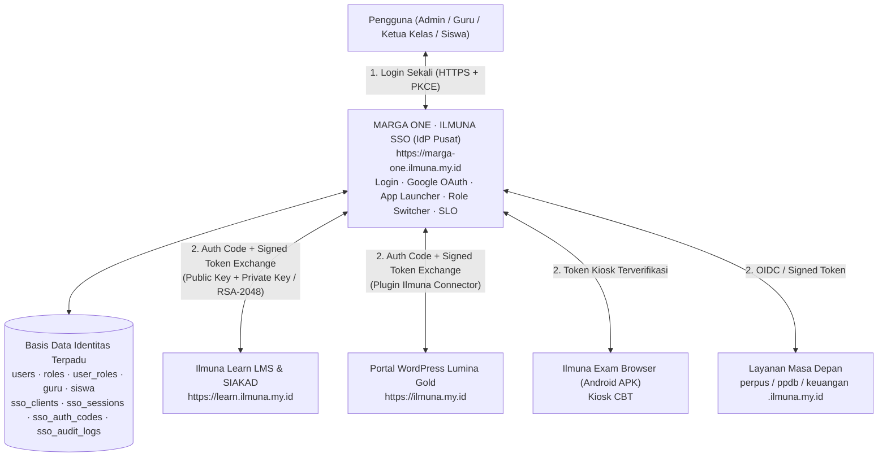
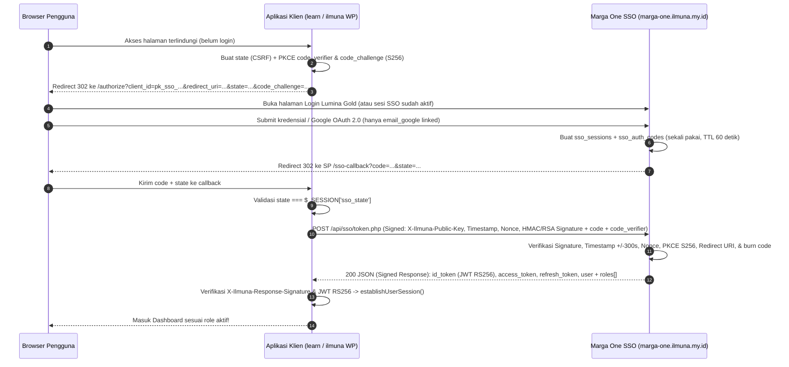

# 🔐 MARGA ONE (ILMUNA SSO) — MASTER BLUEPRINT & CIKAL BAKAL SINGLE SIGN-ON EKOSISTEM ILMUNA

> **Single Source of Truth untuk Pembangunan Portal Identitas Terpusat (`marga-one.ilmuna.my.id`)**  
> **Prinsip Utama:** 100% **1 Tema (Lumina Gold & Sentuhan Nusantara)**, **1 Standar UI/UX** (Data-First, Zero Page Reload, `window.Ilmuna`, Solar Icons), **1 Fondasi Keamanan Zero-Trust** (Public Key + Private Key HMAC-SHA256 / RSA-2048 / PKCE), dan **100% Kompatibel Skema Identitas & PHP 7.4+** dengan `learn.ilmuna.my.id` serta WordPress `ilmuna.my.id`.

---

## 📑 DAFTAR ISI

1. [Visi & Topologi Ekosistem Ilmuna SSO](#1-visi--topologi-ekosistem-ilmuna-sso)
2. [Standar Paritas Tema 100% Identik (Lumina Gold & Nusantara)](#2-standar-paritas-tema-100-identik-lumina-gold--nusantara)
3. [Aset & Komponen Wajib yang Disalin 1:1 dari `learn`](#3-aset--komponen-wajib-yang-disalin-11-dari-learn)
4. [Arsitektur Protokol SSO & Keamanan Zero-Trust](#4-arsitektur-protokol-sso--keamanan-zero-trust)
5. [Skema Basis Data Identitas & Tabel SSO](#5-skema-basis-data-identitas--tabel-sso)
6. [Aturan Wajib Server Produksi (cPanel PHP 7.4 & Guardian Dome WAF)](#6-aturan-wajib-server-produksi-cpanel-php-74--guardian-dome-waf)
7. [Struktur Direktori Proyek `sso` yang Direkomendasikan](#7-struktur-direktori-proyek-sso-yang-direkomendasikan)
8. [Rencana Integrasi ke `learn.ilmuna.my.id` & WordPress `ilmuna.my.id`](#8-rencana-integrasi-ke-learnilmunamyid--wordpress-ilmunamyid)
9. [Prompt Starter Siap Pakai untuk Sesi Pembangunan SSO](#9-prompt-starter-siap-pakai-untuk-sesi-pembangunan-sso)

---

## 1. VISI & TOPOLOGI EKOSISTEM ILMUNA SSO

**Marga One (Ilmuna SSO)** di **`https://marga-one.ilmuna.my.id`** berperan sebagai **Identity Provider (IdP)** tunggal untuk seluruh layanan digital ekosistem Ilmuna sehingga Admin, Guru, Ketua Kelas, dan Siswa cukup login **satu kali** (Username/NISN/Email + Password atau Google OAuth 2.0 tertaut) untuk berpindah mulus antar aplikasi.



### Spesifikasi Teknologi Inti (WAJIB Identik dengan `learn.ilmuna.my.id`)
| Lapisan | Standar Wajib | Catatan Penting |
| :--- | :--- | :--- |
| **Backend** | **PHP Native** (Kompatibel penuh **PHP 7.4 `ea-php74`** hingga **PHP 8.3**) | Tanpa framework berat (No Laravel/CI). **DILARANG** sintaks PHP 8-only (`match`, `?->`, union types, `readonly`, named args). |
| **Database** | **MySQL / MariaDB InnoDB** (`utf8mb4_unicode_ci`) via PDO Singleton | 100% Prepared Statements, `SET time_zone = '+07:00'`, Timezone PHP `Asia/Jakarta`. |
| **Frontend** | **Vanilla ES6+ & CSS3 Variables** | Fetch API async, CSS Grid/Flexbox, tanpa React/Vue/jQuery/Bootstrap. |
| **Ikon Resmi** | **Iconify Solar Icons** (`solar:*-bold`, `solar:*-bold-duotone`, `solar:*-linear`) | CDN resmi: `https://code.iconify.design/iconify-icon/2.1.0/iconify-icon.min.js`. Dilarang campur icon pack lain. |
| **Alert & Dialog** | **`window.Ilmuna`** (`assets/js/alert.js`) | Dilarang keras `alert()`, `confirm()`, `prompt()`, SweetAlert, atau Toastr! |
| **Interaksi** | **Zero Page Reload** (Lazy Load + In-Place DOM) | Mutasi CRUD via JSON API + animasi `.row-flash` / `.row-smooth-out`. |

---

## 2. STANDAR PARITAS TEMA 100% IDENTIK (LUMINA GOLD & NUSANTARA)

SSO **wajib** terasa seperti satu kesatuan visual utuh dengan `learn.ilmuna.my.id` DAN tema WordPress `lumina-gold` (`ilmuna.my.id`).

### 2.1 Design Tokens CSS Resmi (Salin Persis ke `:root`)
```css
:root {
    /* Palet Inti Lumina Gold (Identik learn.ilmuna.my.id & WordPress lumina-gold) */
    --lumina-navy: #1D3B5E;
    --lumina-navy-dark: #13273F;
    --lumina-teal: #0D7A87;
    --lumina-teal-dark: #095963;
    --lumina-sky: #52B2DC;
    --lumina-sky-soft: #7CC5E5;
    --lumina-gold: #F59E0B;
    --lumina-amber: #D97706;
    --lumina-emerald: #10B981;
    --lumina-rose: #EF4444;

    /* Gradien Resmi */
    --lumina-gradient: linear-gradient(135deg, #1D3B5E 0%, #0D7A87 52%, #52B2DC 100%);
    --lumina-gradient-panel: linear-gradient(135deg, #1D3B5E 0%, #0D7A87 50%, #152C47 100%);
    --lumina-gradient-hover: linear-gradient(135deg, #254B77 0%, #1197A7 52%, #68C2E7 100%);

    /* Permukaan Light Mode (Solid Opaque) */
    --lumina-bg-canvas: #F8FAFC;
    --lumina-bg-light: #F4F8FA;
    --lumina-bg-card: #FFFFFF;
    --lumina-border: #E2E8F0;
    --lumina-border-subtle: #DEE7EE;
    --lumina-text-title: #0F1D2F;
    --lumina-text-body: #334155;
    --lumina-text-muted: #64748B;

    /* Permukaan Dark Mode (Serasi WordPress lumina-gold) */
    --lumina-bg-dark: #0B1523;
    --lumina-bg-dark-card: #102035;
    --lumina-border-dark: rgba(82, 178, 220, 0.24);

    /* Tipografi Resmi */
    --font-heading: 'Outfit', -apple-system, BlinkMacSystemFont, 'Segoe UI', sans-serif;
    --font-body: 'Plus Jakarta Sans', -apple-system, BlinkMacSystemFont, 'Segoe UI', sans-serif;
    --font-mono: 'JetBrains Mono', 'Fira Code', Consolas, monospace;

    /* Radius & Elevasi */
    --radius-sm: 8px;
    --radius-md: 16px;
    --radius-lg: 24px;
    --radius-pill: 9999px;
    --shadow-card: 0 12px 32px -12px rgba(29, 59, 94, 0.16), 0 2px 8px rgba(29, 59, 94, 0.06);
    --shadow-glow: 0 12px 35px -8px rgba(13, 122, 135, 0.45);
    --ease-smooth: cubic-bezier(0.16, 1, 0.3, 1);
}
```

### 2.2 Ciri Khas Visual Halaman SSO (100% Mewarisi `login.php` & `gateway.php`)
1. **Halaman Login & Otorisasi SSO (`/login`, `/authorize`)**:
   - **Viewport Lock (No Vertical Scroll)**: `height: 100dvh; overflow: hidden;` dengan wrapper responsif `max-width: 1200px`.
   - **Split-Panel Overlap Identik `login.php`**:
     - Panel kiri (`.slide-panel`): Gradien `linear-gradient(135deg, #1D3B5E 0%, #0D7A87 50%, #152C47 100%)`, `border-radius: 28px`, `border-bottom-right-radius: 60px`, menampilkan logo bercahaya, identitas aplikasi tujuan (`Masuk ke Ilmuna Learn` / `Masuk ke Portal Ilmuna`), serta info keamanan sesi.
     - Panel kanan (form card): Solid putih `#FFFFFF` overlap elegan dengan input berikon, tombol **Masuk** gradasi Lumina, dan tombol **Masuk dengan Google** (mengikuti aturan ketat `users.email_google` linked-only).
   - **Efek Atmosfer**: `#particleCanvas` halus, `.glow-orb` teal lembut, dan `.page-transition` (radial wave `#E8EFF7` → `#52B2DC` → `#0D7A87`) saat transisi redirect!
2. **Halaman App Launcher & Role Gateway (`/gateway` / `/portal`)**:
   - Menggunakan layout split-panel yang sama persis dengan `gateway.php`.
   - Menampilkan **Daftar Aplikasi Ekosistem** (`Ilmuna Learn LMS`, `Portal WordPress`, dll.) beserta **Pilihan Peran Aktif** (`Admin`, `Guru`, `Ketua Kelas`, `Siswa`) bila pengguna memiliki multi-role.
   - Auto-redirect langsung ke aplikasi tujuan bila hanya punya 1 peran & berasal dari `redirect_uri` valid (kecuali `?force=1`).
3. **Panel Admin SSO (`/dashboard/admin/*`) — Hukum Data-First**:
   - **ZERO Page Title / ZERO Subtitle** di body konten (nama halaman cukup di header/breadcrumb).
   - **ZERO KPI Stat Cards** — gunakan `.curriculum-tab-counter` di dalam **Segmented Tabs** (`.curriculum-main-tabs`) persis `dashboard/admin/curriculum.php`, `dashboard/admin/schedules.php`, dan `dashboard/admin/api-wordpress.php`.
   - **Ultra-Responsive Mobile (`360px+`)**: Zero `overflow-x`, touch target minimal `44px`, tabel terbungkus `.table-responsive` atau berubah ke card stack.
4. **Sentuhan Nusantara (`assets/js/alert.js`)**:
   - Watermark siluet `gunungan.png` (`opacity: 0.08–0.10`), tekstur Batik Kawung (`3%`), sudut melengkung asimetris `border-radius: 32px 0 16px 0`, serta ornamen sudut vektor SVG batik.
5. **Kompatibilitas Embed / Widget di WordPress `lumina-gold`**:
   - Setiap komponen UI SSO yang tampil di WordPress (tombol login SSO, widget status sesi) WAJIB memiliki `position: relative !important; z-index: 60 !important; isolation: isolate !important;` + permukaan solid opaque (bukan transparan) agar selalu berada di atas `#ilmuna-ornaments` (`z-index: 0`) dan di bawah sticky navbar (`z-index: 1000`), serta mendukung `html[data-ilmuna-theme="dark"]` dan `body.dark-mode`.

---

## 3. ASET & KOMPONEN WAJIB YANG DISALIN 1:1 DARI `learn`

Saat memulai proyek `sso`, salin langsung file inti berikut dari `c:\laragon\www\learn\` agar 100% seragam tanpa membuat ulang dari nol:

| Kategori | File Sumber di `learn` | Fungsi di Proyek `sso` |
| :--- | :--- | :--- |
| **Alert & Dialog** | `assets/js/alert.js` | Engine `window.Ilmuna` (Toast, Confirm, Alert Nusantara). |
| **CSS Core & Mobile** | `assets/css/lumina-lms.css`, `assets/css/ilmuna-unified-responsive.css` | Token warna, `.curriculum-main-tabs`, `.ilmuna-badge--*`, responsive `360px+`. |
| **Template Shell** | `includes/header.php`, `includes/footer.php`, `includes/sidebar.php`, `includes/menu.php` | Layout Admin SSO, topbar, sidebar, loader Iconify & PWA. |
| **Template UI** | `includes/modal-template.php`, `includes/table-template.php`, `includes/calendar-template.php` | Modal, tabel responsif, dan date picker universal. |
| **Auth & Login UX** | `login.php`, `gateway.php`, `auth.php`, `profile.php` | Referensi langsung UI split-panel, Google OAuth 2.0, CSRF, dan multi-role RBAC. |
| **Engine Keamanan API** | `includes/wp-api-security.php` | Cikal bakal engine Public Key + Private Key (AES-256 at-rest, HMAC-SHA256, RSA-2048 PEM, DUAL mode, Nonce anti-replay, Rate Limit, Signed Response, Audit Log). |
| **Aset Brand** | `assets/images/logo-learn.png`, `landscape-logo-learn.png`, `logo.ico`, `assets/img/gunungan.png`, `assets/pwa/*` | Identitas visual, favicon, watermark gunungan, ikon PWA. |

---

## 4. ARSITEKTUR PROTOKOL SSO & KEAMANAN ZERO-TRUST

Ilmuna SSO menggabungkan **OAuth 2.0 Authorization Code + PKCE (`S256`)** untuk alur browser dengan **Zero-Trust Dual-Key Signing (`Public Key + Private Key`)** dari `includes/wp-api-security.php` untuk pertukaran token server-to-server.

### 4.1 Alur Autentikasi Lengkap (Sequence)


### 4.2 Daftar Endpoint Standar Ilmuna SSO
| Endpoint | Metode | Proteksi | Fungsi |
| :--- | :--- | :--- | :--- |
| `/login` | `GET`/`POST` | CSRF + Honeypot + Rate Limit + CSP | Login terpusat (Username/Email/NISN + Password atau Google OAuth 2.0). |
| `/authorize` | `GET` | Whitelist `client_id` + `redirect_uri` + PKCE `S256` | Menerbitkan `authorization_code` sekali pakai (TTL 60 detik). |
| `/gateway` | `GET` | Sesi SSO aktif | App Launcher (pindah antar `learn`, `ilmuna`, dll.) & Role Switcher. |
| `/logout` | `GET`/`POST` | CSRF + `id_token_hint` | **Single Logout (SLO)**: hapus sesi SSO & kirim webhook logout bertanda tangan ke semua SP. |
| `/api/sso/token.php` | `POST` | Public/Private Key (`HMAC-SHA256` / `RSA-2048` / `DUAL`) + Nonce + PKCE | Tukar `authorization_code` atau `refresh_token` menjadi JWT `id_token` + `access_token`. |
| `/api/sso/userinfo.php` | `GET` | Bearer `access_token` + Signed Client Header | Ambil profil terkini + `roles[]`, `guru_id`, `siswa_id` (zero sensitive secret). |
| `/api/sso/introspect.php` | `POST` | Public/Private Key Signature | Cek apakah sesi global user masih aktif / sudah di-revoke (validasi real-time). |
| `/api/sso/jwks.php` | `GET` | Publik (Read-Only, Cacheable) | Publikasikan RSA-2048 Public Key (`JWK`) agar SP bisa verifikasi JWT `RS256` secara lokal. |

### 4.3 Daftar Proteksi Wajib (Mewarisi `includes/wp-api-security.php`)
- **Enkripsi Private Key at-rest**: AES-256-CBC + HMAC-SHA256 (`Encrypt-then-MAC`) di database — tidak pernah hardcoded di Git!
- **Canonical Request Signature**: `METHOD + "\n" + CANONICAL_PATH + "\n" + SORTED_QUERY + "\n" + TIMESTAMP + "\n" + NONCE + "\n" + SHA256(BODY)` diverifikasi dengan `hash_equals()`.
- **Anti-Replay**: Timestamp ±300 detik + tabel `sso_nonces` (unique per `public_key` + `nonce_hash`).
- **PKCE Wajib (`S256`)** untuk mencegah Authorization Code Interception.
- **Refresh Token Rotation & Reuse Detection**: Jika refresh token lama dipakai ulang, seluruh token family otomatis di-revoke!
- **Strict Google OAuth Linking**: Mengikuti hukum `auth.php` (`loginUserByGoogle()`): **HANYA** izinkan login Google jika `users.email_google` sudah ditautkan eksplisit di `/profile` — **JANGAN PERNAH** auto-register akun baru dari halaman login!
- **Cookie & Security Headers**: `HttpOnly`, `Secure`, `SameSite=Lax`, `session_regenerate_id(true)`, `X-Frame-Options: SAMEORIGIN`, `X-Content-Type-Options: nosniff`, `Content-Security-Policy` ketat.

---

## 5. SKEMA BASIS DATA IDENTITAS & TABEL SSO

### 5.1 Kontrak Tabel Identitas Existing (WAJIB Dipertahankan Kompatibel dengan `learn`)
Pelajaran krusial dari produksi `learn.ilmuna.my.id` yang **HARUS** selalu dipatuhi oleh SSO:
1. **`users`** (`id, username, email, email_google, google_id, password_hash, full_name, nisn_nip, gender, phone, foto_profil, status, is_active, last_login, created_at`):
   - `users.id` adalah **Primary Key referensi Foreign Key** untuk `guru.id_user`, `tugas.id_guru`, `proyek.id_guru`, `modul_ajar.id_guru`, `nilai_tugas.id_guru`, `perizinan.id_guru`, `jadwal_pelajaran.id_guru`, `alokasi_hari_mengajar.id_guru`, `prota.id_guru`, dan `prosem.id_guru`.
   - Password menggunakan `password_hash(..., PASSWORD_DEFAULT)` dan diverifikasi dengan `password_verify()`.
2. **`roles` & `user_roles`** (Multi-Role RBAC):
   - Role baku: `admin`, `guru`, `ketua_kelas`, `siswa` (dapat diperluas misal `wp_editor`, `pustakawan`, `bendahara` untuk aplikasi ekosistem lain).
   - Urutan prioritas peran berdasarkan `user_roles.is_primary DESC, roles.id ASC`.
3. **`guru`** (`id, id_user, nama_guru, nip, email, ...`) & **`siswa`** (`id, id_kelas, nisn, nis, nama_lengkap, gmail, ...`):
   - **Perhatian kolom**: `siswa` memakai `nama_lengkap` (BUKAN `nama_siswa`) dan `gmail` (BUKAN `email`).
   - Selalu sertakan mekanisme auto-heal anti-orphan `guru.id_user` (mewarisi `ilmuna_resolve_logged_guru()` dari `includes/academic-sync-engine.php`).

### 5.2 DDL Tabel Baru untuk Server SSO (Auto-Migrated)
```sql
-- 1. Daftar Aplikasi Klien SSO (Service Providers: learn, ilmuna WP, APK, dll.)
CREATE TABLE IF NOT EXISTS sso_clients (
    id INT AUTO_INCREMENT PRIMARY KEY,
    client_name VARCHAR(120) NOT NULL,
    client_slug VARCHAR(60) NOT NULL UNIQUE,
    public_key VARCHAR(120) NOT NULL UNIQUE,       -- pk_sso_... (client_id)
    private_key_enc TEXT NOT NULL,                 -- AES-256-CBC+HMAC encrypted sk_sso_...
    private_key_hash CHAR(64) NOT NULL,
    rsa_public_pem TEXT NULL,                      -- Opsional untuk mode RSA-SHA256 / DUAL
    sig_mode ENUM('HMAC-SHA256','RSA-SHA256','DUAL') NOT NULL DEFAULT 'HMAC-SHA256',
    app_url VARCHAR(255) NOT NULL,                 -- Untuk App Launcher (/gateway)
    app_icon VARCHAR(80) NOT NULL DEFAULT 'solar:widget-5-bold',
    redirect_uris TEXT NOT NULL,                   -- Pisahkan newline/koma (exact match!)
    logout_webhook_url VARCHAR(255) NULL,          -- Back-channel Single Logout (SLO)
    allowed_domains TEXT NOT NULL,
    allowed_ips TEXT NULL,
    allowed_scopes VARCHAR(255) NOT NULL DEFAULT 'openid,profile,email,roles',
    allowed_roles VARCHAR(255) NOT NULL DEFAULT 'admin,guru,ketua_kelas,siswa',
    rate_limit_per_min INT NOT NULL DEFAULT 180,
    is_active TINYINT(1) NOT NULL DEFAULT 1,
    last_used_at DATETIME NULL,
    created_at DATETIME NOT NULL DEFAULT CURRENT_TIMESTAMP,
    updated_at DATETIME NOT NULL DEFAULT CURRENT_TIMESTAMP ON UPDATE CURRENT_TIMESTAMP
) ENGINE=InnoDB DEFAULT CHARSET=utf8mb4 COLLATE=utf8mb4_unicode_ci;

-- 2. Sesi Global SSO Lintas Aplikasi
CREATE TABLE IF NOT EXISTS sso_sessions (
    id BIGINT AUTO_INCREMENT PRIMARY KEY,
    session_token_hash CHAR(64) NOT NULL UNIQUE,
    user_id INT NOT NULL,
    active_role VARCHAR(40) NULL,
    ip_address VARCHAR(64) NOT NULL,
    user_agent VARCHAR(255) NULL,
    login_method ENUM('password','google_oauth','magic_qr') NOT NULL DEFAULT 'password',
    expires_at DATETIME NOT NULL,
    revoked_at DATETIME NULL,
    last_activity_at DATETIME NOT NULL DEFAULT CURRENT_TIMESTAMP,
    created_at DATETIME NOT NULL DEFAULT CURRENT_TIMESTAMP,
    INDEX idx_sso_sess_user (user_id, revoked_at),
    INDEX idx_sso_sess_exp (expires_at)
) ENGINE=InnoDB DEFAULT CHARSET=utf8mb4 COLLATE=utf8mb4_unicode_ci;

-- 3. Authorization Codes Sekali Pakai (OAuth2 + PKCE S256, TTL 60 detik)
CREATE TABLE IF NOT EXISTS sso_auth_codes (
    id BIGINT AUTO_INCREMENT PRIMARY KEY,
    code_hash CHAR(64) NOT NULL UNIQUE,
    client_id INT NOT NULL,
    user_id INT NOT NULL,
    sso_session_id BIGINT NOT NULL,
    redirect_uri VARCHAR(255) NOT NULL,
    scope VARCHAR(255) NOT NULL,
    code_challenge VARCHAR(128) NOT NULL,
    code_challenge_method VARCHAR(10) NOT NULL DEFAULT 'S256',
    nonce VARCHAR(128) NULL,
    expires_at DATETIME NOT NULL,
    used_at DATETIME NULL,
    created_at DATETIME NOT NULL DEFAULT CURRENT_TIMESTAMP,
    INDEX idx_sso_code_exp (expires_at)
) ENGINE=InnoDB DEFAULT CHARSET=utf8mb4 COLLATE=utf8mb4_unicode_ci;

-- 4. Refresh Tokens dengan Family Rotation (Anti Token Theft)
CREATE TABLE IF NOT EXISTS sso_refresh_tokens (
    id BIGINT AUTO_INCREMENT PRIMARY KEY,
    token_hash CHAR(64) NOT NULL UNIQUE,
    family_id CHAR(36) NOT NULL,
    client_id INT NOT NULL,
    user_id INT NOT NULL,
    sso_session_id BIGINT NOT NULL,
    expires_at DATETIME NOT NULL,
    rotated_at DATETIME NULL,
    revoked_at DATETIME NULL,
    created_at DATETIME NOT NULL DEFAULT CURRENT_TIMESTAMP,
    INDEX idx_sso_rt_family (family_id),
    INDEX idx_sso_rt_user (user_id, revoked_at)
) ENGINE=InnoDB DEFAULT CHARSET=utf8mb4 COLLATE=utf8mb4_unicode_ci;

-- 5. Anti-Replay Nonce, Rate Limit & Audit Trail (Identik Pola wp_api_*)
CREATE TABLE IF NOT EXISTS sso_nonces (
    id BIGINT AUTO_INCREMENT PRIMARY KEY,
    public_key VARCHAR(120) NOT NULL,
    nonce_hash CHAR(64) NOT NULL,
    expires_at DATETIME NOT NULL,
    UNIQUE KEY uq_sso_pk_nonce (public_key, nonce_hash),
    INDEX idx_sso_nonce_exp (expires_at)
) ENGINE=InnoDB DEFAULT CHARSET=utf8mb4 COLLATE=utf8mb4_unicode_ci;

CREATE TABLE IF NOT EXISTS sso_audit_logs (
    id BIGINT AUTO_INCREMENT PRIMARY KEY,
    user_id INT NULL,
    client_id INT NULL,
    event_type VARCHAR(60) NOT NULL,   -- login_ok, login_fail, code_issued, token_issued, slo_logout, replay_blocked
    http_status SMALLINT NOT NULL DEFAULT 200,
    ip_address VARCHAR(64) NOT NULL,
    user_agent VARCHAR(255) NULL,
    detail_json TEXT NULL,
    created_at DATETIME NOT NULL DEFAULT CURRENT_TIMESTAMP,
    INDEX idx_sso_audit_created (created_at),
    INDEX idx_sso_audit_event (event_type)
) ENGINE=InnoDB DEFAULT CHARSET=utf8mb4 COLLATE=utf8mb4_unicode_ci;
```

---

## 6. ATURAN WAJIB SERVER PRODUKSI (CPANEL PHP 7.4 & GUARDIAN DOME WAF)

1. **Isolasi Endpoint Server-to-Server (`/api/sso/`) dari HTML Interstitial Guardian Dome**:
   - Semua endpoint machine-to-machine (`/api/sso/token.php`, `/api/sso/userinfo.php`, `/api/sso/introspect.php`, `/api/sso/jwks.php`) **WAJIB** ditempatkan di folder terisolasi `api/sso/` dengan:
     - `api/sso/.htaccess`:
       ```apache
       <IfModule lsapi_module>
           php_value auto_prepend_file none
       </IfModule>
       <IfModule php7_module>
           php_value auto_prepend_file none
       </IfModule>
       <IfModule mod_rewrite.c>
           RewriteEngine On
           RewriteRule .* - [E=HTTP_AUTHORIZATION:%{HTTP:Authorization}]
       </IfModule>
       ```
     - `api/sso/.user.ini`: `auto_prepend_file = none`
     - `define('ILMUNA_SKIP_GD_WAF_INTERSTITIAL', true);` sebelum `require_once 'config.php';`.
   - Seluruh halaman browser (`/login`, `/authorize`, `/gateway`, `/dashboard/*`) tetap 100% dilindungi Guardian Dome WAF!
2. **Kompatibilitas PHP 7.4 (`ea-php74`)**:
   - Jangan gunakan fungsi PHP 8 tanpa guard; berikan fallback `function_exists('mb_strlen')` / `mb_substr` seperti di `includes/wp-api-data.php`.
   - Untuk pembangkitan RSA-2048 PEM di Windows (Laragon) maupun Linux (cPanel), gunakan helper pencarian `openssl.cnf` persis `ilmuna_wp_api_find_openssl_cnf()` di `includes/wp-api-security.php`.

---

## 7. STRUKTUR DIREKTORI PROYEK `sso` YANG DIREKOMENDASIKAN

```text
c:\laragon\www\marga-one\   (Domain Produksi: https://marga-one.ilmuna.my.id)
├── 📂 api/
│   └── 📂 sso/
│       ├── .htaccess                 # php_value auto_prepend_file none (LiteSpeed/Apache)
│       ├── .user.ini                 # auto_prepend_file = none
│       ├── token.php                 # Signed OAuth2 + PKCE Token Exchange & Refresh Rotation
│       ├── userinfo.php              # Profil & Role pengguna terverifikasi
│       ├── introspect.php            # Validasi status sesi global real-time
│       ├── jwks.php                  # Public Key RSA-2048 (JWK Set) untuk verifikasi JWT
│       └── logout-callback.php       # Back-channel Single Logout handler
├── 📂 assets/                        # Disalin 1:1 dari learn (lumina-lms.css, ilmuna-unified-responsive.css, alert.js, images, img/gunungan.png, pwa)
├── 📂 dashboard/
│   └── 📂 admin/
│       ├── index.php                 # Ringkasan & monitoring sesi aktif (Data-First)
│       ├── clients.php               # Manajemen Aplikasi Klien SSO (Public/Private Key, RSA PEM, Redirect URI, Whitelist)
│       ├── sessions.php              # Manajemen & Revoke Sesi Aktif lintas aplikasi (Force Logout 1-klik)
│       ├── users.php                 # Sinkronisasi akun, multi-role, & tautan Google SSO
│       └── audit-logs.php            # Log keamanan login, token exchange, & blokir serangan
├── 📂 includes/
│   ├── sso-security.php              # Adaptasi langsung includes/wp-api-security.php + JWT RS256 + PKCE S256
│   ├── header.php / footer.php / sidebar.php / menu.php
│   └── modal-template.php / table-template.php / calendar-template.php
├── 📂 sdk/
│   ├── ilmuna-sso-client.php         # Drop-in PHP Client SDK untuk learn.ilmuna.my.id & app PHP lainnya
│   └── wordpress-sso-addon.php       # Ekstensi tombol "Masuk dengan Ilmuna SSO" untuk WordPress ilmuna.my.id
├── 📄 config.php                     # Koneksi DB bersama / replika, APP_DOMAIN, Google OAuth, Favicon/Iconify helper
├── 📄 auth.php                       # Manajemen sesi global SSO & RBAC
├── 📄 login.php                      # UI Split-Panel Lumina Gold (identik 100% learn/login.php)
├── 📄 authorize.php                  # Endpoint OAuth2 + PKCE Authorize
├── 📄 gateway.php                    # Portal App Launcher & Role Switcher (identik learn/gateway.php)
├── 📄 profile.php                    # Profil terpusat, ganti password, tautkan/putus Google SSO, sesi perangkat
├── 📄 logout.php                     # Global Single Logout (SLO)
├── 📄 deploy.php                     # Auto-deployer Git cPanel
└── 📄 .htaccess                      # Clean URLs + Guardian Dome (kecuali api/sso/)
```

---

## 8. RENCANA INTEGRASI KE `learn.ilmuna.my.id` & WORDPRESS `ilmuna.my.id`

### 8.1 Integrasi ke `learn.ilmuna.my.id` (Zero Downtime & Ada Fallback)
1. Tambahkan flag konfigurasi di `learn/config.php`:
   ```php
   define('ILMUNA_SSO_ENABLED', false); // Ubah ke true setelah marga-one.ilmuna.my.id siap produksi
   define('ILMUNA_SSO_URL', 'https://marga-one.ilmuna.my.id');
   define('ILMUNA_SSO_PUBLIC_KEY', '');  // Diisi dari panel Admin Marga One SSO
   define('ILMUNA_SSO_PRIVATE_KEY', ''); // Disimpan aman di DB/env server
   ```
2. Tambahkan endpoint `learn/sso-callback.php`:
   - Menerima `code` + `state` dari `marga-one.ilmuna.my.id`, tukar token via `POST /api/sso/token.php` (PKCE + Signed Header), verifikasi JWT `RS256`, lalu panggil **`establishUserSession($pdo, $user)`** di `learn/auth.php` sehingga seluruh 51+ modul dashboard Admin/Guru/Ketua Kelas/Siswa langsung berjalan tanpa mengubah 1 baris pun kode modul dashboard!
3. Tambahkan tombol **"Masuk via Marga One SSO"** di `learn/login.php` (dan mode auto-redirect jika `ILMUNA_SSO_ENFORCED === true`, sambil tetap menyediakan jalur login darurat Admin lokal).

### 8.2 Integrasi ke WordPress `ilmuna.my.id` (Tema `lumina-gold`)
1. Perluas plugin `wordpress-plugin/ilmuna-learn-connector/ilmuna-learn-connector.php` (atau plugin pendamping `marga-one-sso-wp`) dengan:
   - Tombol **"Masuk dengan Marga One (Akun Ilmuna)"** di `wp-login.php` dan shortcode `[ilmuna_sso_button]` (1 tema `lumina-gold`, `z-index: 60`, Light & Dark Mode).
   - Auto-mapping peran: `admin` → WP `administrator`, `guru` → WP `editor`/`author`, `siswa` → WP `subscriber`.
   - Back-channel Single Logout (SLO): saat user logout di `learn.ilmuna.my.id`, sesi WordPress di `ilmuna.my.id` ikut keluar otomatis!

---

## 9. PROMPT STARTER SIAP PAKAI UNTUK SESI PEMBANGUNAN SSO

Saat Anda siap membangun aplikasi **Marga One (Ilmuna SSO)** di folder proyek baru (misal `c:\laragon\www\marga-one`), cukup salin & kirim prompt berikut di awal sesi:

```text
Tolong bangun aplikasi Marga One — Ilmuna SSO (Single Sign-On & Identity Provider untuk https://marga-one.ilmuna.my.id)
dengan membaca dan mengikuti 100% spesifikasi di file:
- c:\laragon\www\learn\SSO_BLUEPRINT.md
- c:\laragon\www\learn\README.md
- c:\laragon\www\learn\login.php & gateway.php (paritas visual split-panel Lumina Gold)
- c:\laragon\www\learn\includes\wp-api-security.php (engine keamanan Public/Private Key + RSA-2048 + Anti-Replay)

Wajib 100% 1 tema (Lumina Gold & Nusantara), kompatibel PHP 7.4 (ea-php74),
Data-First Zero Title untuk dashboard admin SSO, window.Ilmuna alert.js, Iconify Solar Icons,
OAuth2 + PKCE S256 + JWT RS256 + Single Logout (SLO), isolasi /api/sso/ dari Guardian Dome WAF,
serta siapkan client SDK untuk learn.ilmuna.my.id dan addon WordPress ilmuna.my.id.
```
